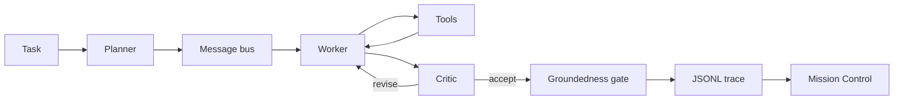
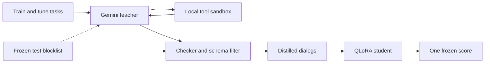

<video src="docs/mission-control.mp4" controls muted playsinline></video>


# Orbit

Orbit is a local planner, worker, and critic over a fictional makerspace corpus. The worker calls tools. The critic sends a bad claim back. A gate refuses any claim the cited tool result does not contain. Mission Control replays the JSONL trace, including a task you start on your own machine.

The measured 1.5B QLoRA run learned the answer format. On the frozen 12-task test it did not produce a task-success gain this sample can support. The paired interval for task success includes zero. That is the result, and the page says so.

## Architecture



The teacher pass sits beside that loop. It never sees the frozen test.



The tools are a sandboxed Python cell, a calculator, corpus file read, a per-run file write, keyword retrieval over the bundled notes, and an offline web cache. Nothing in the tool path opens a socket. The teacher script is the only piece that calls Gemini, and only with a train or tune prompt.

Flight rules, from the code the replay reads:

- The planner returns at most four steps, or an empty plan when the corpus cannot answer.
- The worker emits one tool call or a final answer. Every claim cites a tool result that contains it.
- The critic accepts grounded claims. Otherwise it revises, at most 2 times, and then the gate refuses unsupported claims.
- The team stops after 8 turns. A broken schema gets 2 tries on that turn.

## Results

<!-- RESULTS_START -->
Measured once on the frozen test `team-eval-v1`, Qwen2.5-1.5B-Instruct, QLoRA, 307 train dialogues and 71 tune dialogues. Files: `results/v2_qwen1.5b/`. Logged loss went from 1.152004337310791 at step 10 to 0.05106291174888611 at step 150. Task success did not clear zero.

| Run | Successes | Task-success rate | Schema-valid rate | Trap refusals |
| --- | --- | --- | --- | --- |
| Single base | 2 of 12 | 0.16666666666666666 | 0.75 | 2 of 2 |
| Team base | 2 of 12 | 0.16666666666666666 | 0.6071428571428571 | 2 of 2 |
| Team plus adapter | 3 of 12 | 0.25 | 0.7797619047619048 | 1 of 2 |
| Team distill | not scored | | | |

The adapter's two answerable successes sit next to a missed trap: correct refusals went from 2 to 1. The paired bootstrap for task success, adapter minus team base, is -0.16666666666666666 to 0.3333333333333333 (point 0.08333333333333333). That interval includes zero, so the task-success gain is not statistically significant. The same pair's schema-valid interval is 0.0013888888888889117 to 0.33888888888888885 (point 0.17261904761904764). Schema-valid rate moved. Task success did not, on this 12-task set.

The earlier 0.5B run is in `results/v1_qwen0.5b/`. Successes were 2 of 12, 2 of 12, then 1 of 12, with schema-valid rates 0.0, 0.07083333333333335, and 0.6131944444444445. Logged loss went from 1.3191939353942872 to 0.20024461746215821. Its task-success interval also failed to clear zero. Fine-tuning taught the format.

The placeholder files at the top of `results/` stay pending. A harness file in `results/` is a system check of the scripted tools, not a model score. Team distill is a fourth config. It has not been scored.
<!-- RESULTS_END -->

## Distillation

The templated 307 dialogs taught the JSON shape and not the counting. `finetune/distill_teacher.py` asks a teacher model to act as planner, worker, and critic on train and tune tasks only. Each tool call runs in Orbit's sandbox. A trajectory is kept only when the task checker passes and every turn matches the role schema. Trap tasks stay in the pool so a correct refusal can be kept. The generator adds count, sum, threshold, log, quotient, write, and refusal variants on top of the 69 templated train tasks. Gemini and Claude write the same dialog files. Each kept dialog records the teacher model in its metadata, and `stats.json` records it too.

The frozen test is a local blocklist. Its ids, questions, near-duplicates, distinctive fragments, and oracle calls are not placed in a request and are not written as rows. `--dry-run` prints the pool and does not read an API key.

Cost controls:

- The hard cap defaults to 800 requests. The checkpoint counts requests already spent, so a restart does not reset the cap.
- With `--provider gemini`, the client waits so the pace stays near 4 requests per minute. Each request log prints that configured rate, the effective rate since the run started, and the count per status code.
- The first request is a preflight with no task text. A client error there exits before any task is sent.
- HTTP 503 waits 20 seconds, then 40, then 80. Each of those retries counts toward the cap. After that the process stops.
- A per-minute HTTP 429 whose stated retry delay is 120 seconds or less waits that long once and continues. A per-day quota, a longer delay, or a second consecutive 429 stops the process and writes the checkpoint.
- Any other client error stops the process on that response. The run does not send another request.
- Another server error is tried up to 3 times, then the process stops.
- A model whose name starts with gemma does not receive a system instruction field. That text is placed in the first user turn.
- Token counts and the request total are printed as JSON lines.
- If the Google project has billing turned on, successful calls can still incur charges up to the cap. Confirm billing is off before you export the key.

```bash
python finetune/distill_teacher.py --dry-run
export ORBIT_ANTHROPIC_API_KEY=your-key
python finetune/distill_teacher.py \
  --provider anthropic \
  --model claude-haiku-5-5 \
  --max-requests 800 \
  --requests-per-minute 20 \
  --max-cost-usd 5 \
  --attempts 3 \
  --output finetune/data/distill
```

The default provider is Anthropic and the default model is `claude-haiku-5-5`. A name that starts with `claude` selects Anthropic even without `--provider`. `--model` also accepts the Sonnet and Opus ids in the price table. The Anthropic key is read from `ORBIT_ANTHROPIC_API_KEY`. Requests omit temperature unless you pass `--temperature`. The reply is taken from text blocks only. The pace defaults to 20 requests per minute. Request logs include input tokens, output tokens, and a running cost estimate in USD. The estimate uses the price table in `finetune/distill_teacher.py`. The same table is recorded in `finetune/configs/qlora_distill.json`. An unknown model uses the fallback price, 15 dollars per million input tokens and 75 dollars per million output tokens, so the cost limit cannot be under-counted. At 5 USD the run stops and writes the checkpoint. A response that says the credit balance is too low, or any other billing error, stops the same way. HTTP 429 and overloaded or other server errors wait 20 seconds, then 40, then 80, and each retry counts toward the cap. Any other client error stops on that response.

Gemini is still available. Pass `--provider gemini` and set `ORBIT_TEACHER_API_KEY`. That path keeps the free-tier pace of 4 requests per minute and does not apply the dollar limit. A stopped run resumes from `finetune/data/distill/checkpoint.json`. The kept dialogs are `train.jsonl` and `tune.jsonl` in that directory, in the same message format as the templated set, plus `stats.json` with attempts and pass rate per task family.

Train the student with `finetune/configs/qlora_distill.json`. In Colab, set `ORBIT_DISTILL=1` before the distillation cell in `finetune/colab_train.ipynb`. That cell trains the distill config and scores `team_distill` once. The three frozen scores above stay as they are. The comparison adds the distill pairs only when that file is present. Do not score the frozen test in a loop.

## Quickstart

Python 3.11 or newer. The demo target is an 8 GB machine with the 0.5B model. The 1.5B model is slow on that machine but can run in fp16. QLoRA and bitsandbytes are CUDA-only. `make setup` does not install them, and the demo never imports them.

`make doctor` prints seconds for the scripted harness on the machine you run it on. `make doctor-live` downloads Qwen2.5-0.5B-Instruct and prints seconds for one real task. This page does not publish those readings.

### M1 Mac

```bash
python3 -m venv .venv
source .venv/bin/activate
make setup && make doctor
make doctor-live
make demo
```

`make doctor` should print `mps` when PyTorch can see the GPU, and `cpu` when it cannot. Open the localhost URL the server prints. Pick a bundled task id with the scripted harness, or type a question and choose Transformers.

### Linux

```bash
python3 -m venv .venv
source .venv/bin/activate
make setup && make doctor
make doctor-live
make demo
```

Without CUDA or MPS the device line is `cpu`. The same Mission Control page streams the run.

### Windows

`make` may be missing. From a Python 3.11 venv:

```bat
py -3.11 -m venv .venv
.venv\Scripts\activate
py -3.11 -m pip install -e ".[dev]" -r requirements-infer.txt
py -3.11 -m orbit_agents.doctor
py -3.11 -m orbit_agents.doctor --live
py -3.11 -m orbit_agents.serve
```

The Windows device is `cpu`. The Python tool still dies after one second; the limit is a child process.

### What you should see

Mission Control shows the planner, the worker, a tool call in the telemetry strip, and the critic. The phase rail steps Planner, Worker, Tool, Critic. Under the replay, the flight-data wall charts the frozen 1.5B runs with bootstrap intervals, the loss curve, the trap outcomes, and an empty slot for team distill. The T+ column is a replay clock, not measured latency.

`mission/index.html` is static. GitHub Pages can host the `mission` directory, and the same files open under `make demo`. The run form needs the local server. `prefers-reduced-motion` turns the pulses off.

Record the clip again with `python demo/record_replay.py`. It needs Chrome and ffmpeg.

Troubleshooting:

- `torch is not installed` means `make setup` has not been run. QLoRA is still not required.
- `mps` missing on an M1 means the demo is on CPU. The 1.5B model is slow there; use the 0.5B model or Ollama if you want a shorter wait.
- A free-form question with the scripted harness returns an error. That backend only runs a bundled task id.
- Out of memory: stay on the 0.5B default. Do not install bitsandbytes on a Mac to make QLoRA work. That stack is the Colab path.

Pins for the demo live in `requirements-infer.txt`. The Colab training pins live in `finetune/requirements-colab.txt` and do not reinstall torch.

## Fine-tune

On a free T4, open `finetune/colab_train.ipynb` and run it from the top. The default cell trains `finetune/configs/qlora_medium.json` (Qwen2.5-1.5B-Instruct, QLoRA). It targets a free T4 with 16 GB and about 60 minutes for training plus the three evals. That wall clock has not been measured here.

- Optional: set `ORBIT_MOUNT_DRIVE=1` before the first code cell to mount Drive. Otherwise checkpoints stay on the runtime disk under `/content/orbit-checkpoints`.
- Upload the project zip to `/content/orbit.zip` to train that copy. With no zip, the notebook clones https://github.com/shmorsi/orbit-multi-agent.
- The install cell uninstalls torchao, installs `finetune/requirements-colab.txt` with `--upgrade-strategy only-if-needed`, then `pip install -e . --no-deps`, and runs the leakage check.
- Score the frozen test once: single base, team base, team plus the adapter, then the comparison. Set `ORBIT_DISTILL=1` only when the distilled JSONL is in the zip. That adds `team_distill` and does not repeat the three scores in a loop.
- Zip those files to `/content/outputs.zip` and download it.

`finetune/configs/qlora_small.json` is the 0.5B config from the measured v1 run. `--method lora` is the MPS or CPU training path. On an M1, prefer that 0.5B config or Ollama.

Do not score the frozen test in a loop. A new model gets one frozen score. Iterate on the tune split with `python -m orbit_agents.eval.run --split tune`.

## What I built

The team loop, the six tools, the frozen split, the leakage check, the optional LoRA trainer, the teacher distillation script, and Mission Control. The measured model scores are the 0.5B run and the 1.5B run above. Team distill is the next score, and it is not claimed here.
