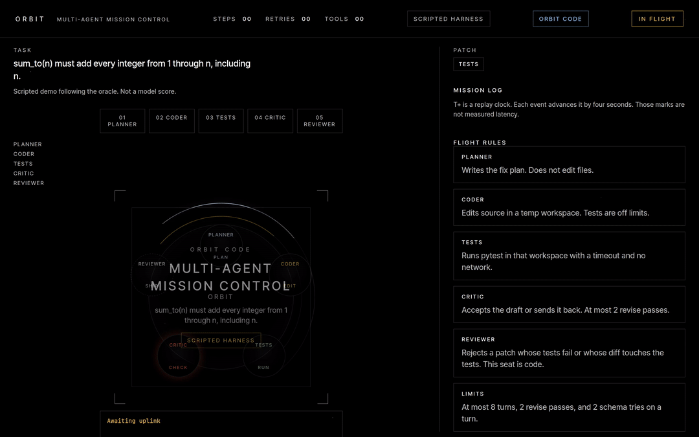
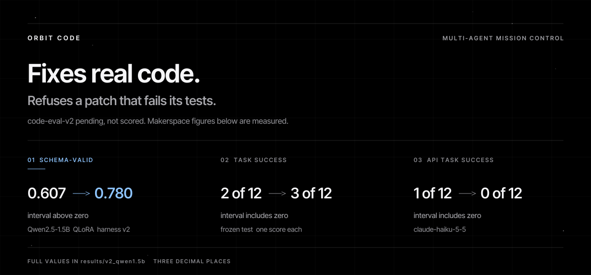
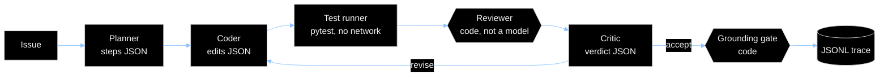
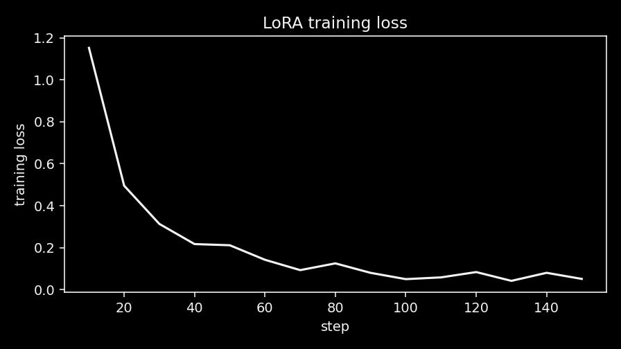
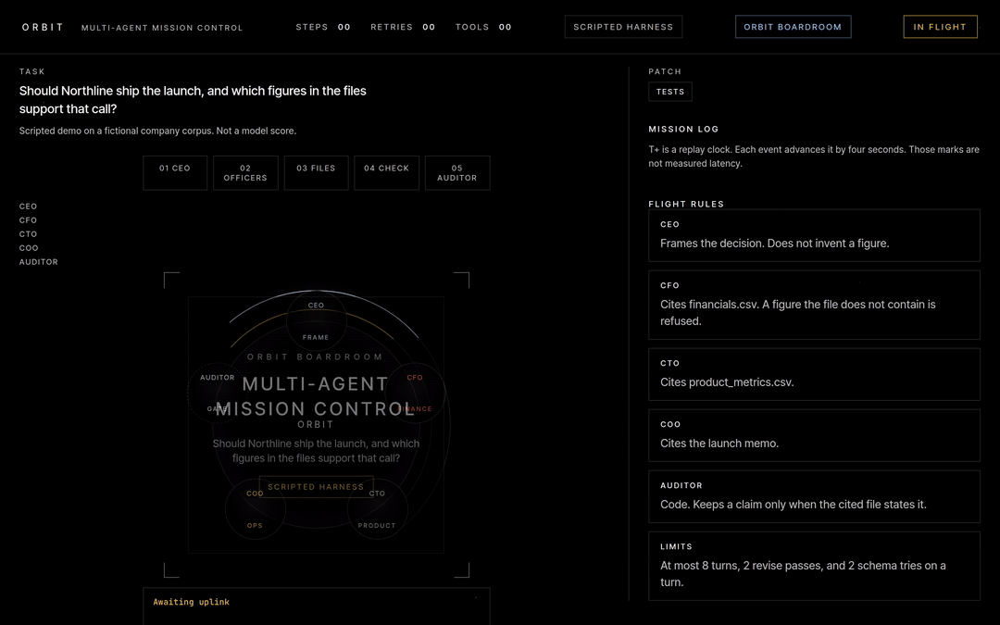
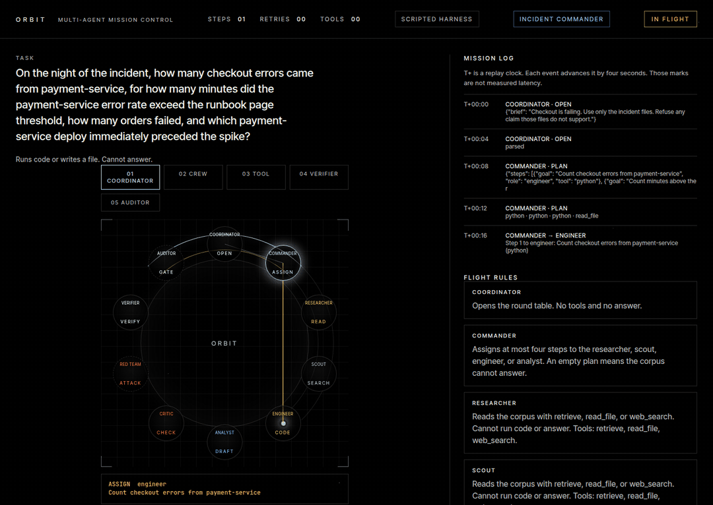
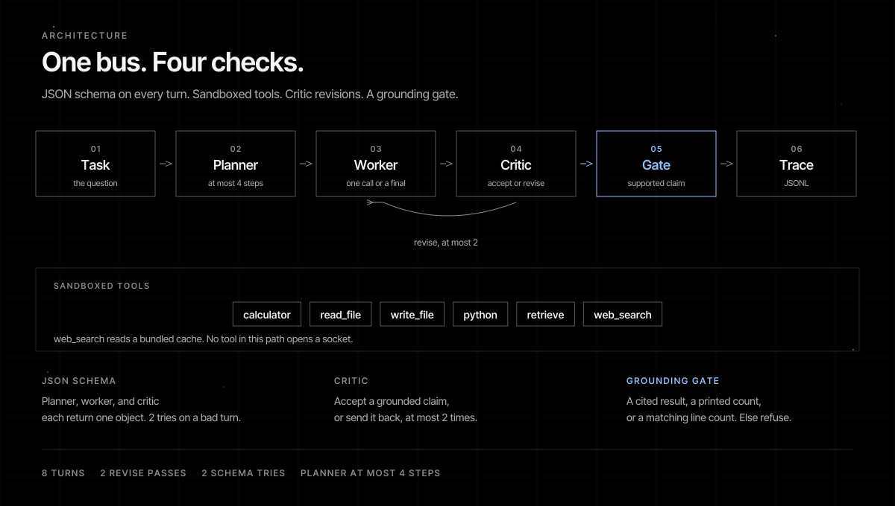
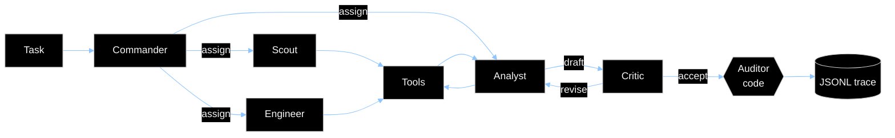

# Orbit

A multi-agent coding team where every message is a schema-checked JSON object, the reviewer is code, and a patch ships only when the tests pass.

[](https://github.com/shmorsi/orbit-multi-agent/actions/workflows/ci.yml)
[](https://www.python.org/downloads/)
[](LICENSE)

[Mission Control](https://shmorsi.github.io/orbit/) · [Portfolio](https://shmorsi.github.io/) · [Key results](#key-results) · [How the agents talk](#how-the-agents-talk) · [Orbit Code](#orbit-code) · [Fine-tuning](#fine-tuning) · [Architecture](#architecture) · [Quickstart](#quickstart)

<p align="center">
  
</p>

<sub>Scripted replay of a toy bug that follows the oracle. The measured scores are below.</sub>

## Key results

Every config was scored once on a frozen split, and every number on this page is read from a committed file under `results/`. A paired bootstrap interval that includes zero is reported as no difference, never as an improvement.

- **Orbit Code.** The team with a reviewer passed 29 of 32 hidden-test tasks; a single agent passed 27 of 32. The paired interval includes zero, so at n = 32 the team is not separated from one agent. The team spent 0.018 USD on the whole split, the single agent 0.007.
- **Fine-tuning.** QLoRA on Qwen2.5-1.5B moved the team's schema-valid rate (0.333 to 0.764 under harness v3, interval above zero). Task success did not clear zero on the 12-task frozen test.
- **Team size.** With the same API model, six roles had a lower schema-valid rate than three (interval below zero) and no task-success difference.

<p align="center">
  
</p>

<!-- RESULTS_START -->
Orbit Code on the frozen split `code-eval-v2`: each config scored once, graded by hidden tests the agents never see. A row is filled only from a measured file under `results/code_v2/`; anything else is pending.

| Config | Model | pass@1 | Tests-passed rate | Reviewer rejections | Tokens | Cost USD |
| --- | --- | --- | --- | --- | --- | --- |
| Single agent | `claude-haiku-5-5` | 27 of 32 | 0.844 | 2 of 32 | 9250 in, 11494 out | 0.007 |
| Team with reviewer | `claude-haiku-5-5` | 29 of 32 | 0.906 | 1 of 32 | 37058 in, 29313 out | 0.018 |
| Single agent, local Qwen | pending | pending, not scored | | | | |

The paired bootstrap for pass@1, team with reviewer minus single agent, is 0.000 to 0.156 (point 0.063). That interval includes zero, so the difference is not significant. n is 32.

The earlier split `code-eval-v1` is superseded: its team pipeline refused a task when the planner reply failed the schema, and a critic accept could end a red build before the coder revised. That record stays in `results/code/claude-haiku-5-5/`. It is not the current score.
<!-- RESULTS_END -->

## How the agents talk

Agents never exchange free-form chat. Each turn is one JSON object, validated against that role's schema before anything acts on it. The seats that decide whether work ships are deterministic code, so no model can talk its way past them.



| Mechanism | What it does | Where |
| --- | --- | --- |
| One JSON object per turn | Every role has its own strict JSON Schema. An invalid reply gets a repair prompt that names the error; after 2 schema tries the turn fails. | `schema.py`, `code_team.py`, `engine.py` |
| Tools restricted per role | The role's tool list is written into its schema as the only allowed `tool` values, so a call outside it fails validation and never runs. | `schema.py` (`ROLE_TOOLS`) |
| Critic revise loop | The critic returns `{"verdict": "accept" or "revise", "reason": ...}`. At most 2 revise passes and 8 turns per task. | `engine.py`, `code_team.py` |
| Reviewer and auditor as code | The reviewer rejects a patch whose tests fail or whose diff touches a test. In the six-role team the auditor checks every claim and number against the tool results. | `code_team.py`, `team_v2.py` |
| Grounding gate | A "tests passed" claim survives only when pytest passed and the reviewer accepted. In the makerspace teams, a claim the cited tool results do not contain turns the answer into a refusal. | `engine.py`, `code_team.py` |
| JSONL traces | Every raw reply, parsed payload, diff, test run, and verdict is one line. Mission Control replays these files and nothing else. | `trace.py`, `mission/traces/` |
| One model interface | Every seat calls `LLMClient.complete(messages, schema)`. Backends: scripted, transformers, ollama, llama.cpp, and anthropic. A new provider is one class. | `policy.py` |

The Orbit Code seats:

| Seat | Model turn | Emits | May touch |
| --- | --- | --- | --- |
| Planner | yes | `{"steps": [{"goal": ...}]}`, at most 4 steps | nothing; cannot edit files |
| Coder | yes | `{"edits": [{"path": ..., "content": ...}]}`, full file contents | source files in a temp workspace; tests are off limits |
| Test runner | no | pass or fail with a summary | pytest in that workspace, with a timeout and no network |
| Reviewer | no | accept or reject | the diff and the test result |
| Critic | yes | `{"verdict": ..., "reason": ...}` | nothing |

A repair, abridged from `mission/traces/code/repair.jsonl` (scripted harness; timestamps and raw text dropped):

```jsonl
{"agent": "planner", "kind": "parsed", "payload": {"steps": [{"goal": "Fix the source so the issue holds, and do not edit tests."}]}}
{"agent": "coder", "kind": "edit", "paths": ["sum_inclusive.py"]}
{"agent": "test_runner", "kind": "test", "ok": false, "summary": "1 failed"}
{"agent": "reviewer", "kind": "review", "verdict": "reject", "reason": "Tests failed. The reviewer rejected the patch."}
{"agent": "critic", "kind": "parsed", "payload": {"verdict": "revise", "reason": "The tests failed. Edit the source and leave the tests alone."}}
{"agent": "coder", "kind": "edit", "paths": ["sum_inclusive.py"]}
{"agent": "test_runner", "kind": "test", "ok": true, "summary": "1 passed"}
{"agent": "reviewer", "kind": "review", "verdict": "accept", "reason": "Tests passed and the diff does not touch tests."}
{"agent": "reviewer", "kind": "gate", "code_verdict": "pass", "claim": {"name": "tests_passed", "value": true}}
```

[Mission Control](https://shmorsi.github.io/orbit/) replays traces like this one, seat by seat. A recording is below ([MP4](docs/mission-control.mp4)); its T+ clock is a replay clock, not measured latency.


## Orbit Code

The coder edits a temp workspace. The test runner executes pytest there with a timeout and no network. The frozen split is `data/scenarios/code_v2/`, protocol `code-eval-v2`, with hidden tests the prompt never sees. `python -m orbit_agents.eval.score_code` checks the manifest hash (and the git tag when it exists) and refuses to overwrite a measured file.

| Config | What runs |
| --- | --- |
| `single` | One coder turn, then the test runner and the reviewer |
| `team` | Planner, coder, test runner, critic, and the reviewer, with revise passes |

Dry-run prints the request bound and the cost cap. It reads no key and writes nothing. Transport retries, including a read timeout, count toward the request cap.

```bash
python -m orbit_agents.eval.score_code --config team --provider anthropic --model claude-haiku-5-5 --dry-run
python -m orbit_agents.eval.score_code --config single --provider transformers --model Qwen/Qwen2.5-1.5B-Instruct --dry-run
```

To score (writes `results/code_v2/<model>/{single,team}.json` once each, then regenerates the results block):

```bash
export ORBIT_ANTHROPIC_API_KEY=your-key
make score-code MODEL=claude-haiku-5-5
```

`make traces-code` rewrites the scripted Mission Control traces: one repair, and one patch the reviewer rejects because it edits a test.

## Fine-tuning

Can a small open model learn the protocol? Qwen2.5 students were trained with QLoRA on templated team dialogues from a fictional makerspace corpus, then scored on the frozen test `team-eval-v1`. The same section compares three-role and six-role teams driven by one API model.

<!-- FINETUNE_START -->
Committed values from `results/`, shown to three decimal places; the JSON files keep full precision. Every config was scored once on the frozen test `team-eval-v1`: 12 tasks, 2 of them traps. Intervals are a paired percentile bootstrap (alpha 0.05, 10000 resamples). An interval that includes zero is not a difference.

#### Qwen2.5-1.5B, harness v3 (current)

Harness v3 changed the tools and the gate: search lists tables and logs, python can read a bundled file by path, a count printed by python or equal to the matching lines in the cited text stays grounded, and the critic must return one JSON object. The four configs were scored again under v3, once each. Files: `results/v3_qwen1.5b/`.

| Run | Successes | Task-success rate | Schema-valid rate | Trap refusals |
| --- | --- | --- | --- | --- |
| Single base | 2 of 12 | 0.167 | 1.000 | 2 of 2 |
| Team base | 2 of 12 | 0.167 | 0.333 | 2 of 2 |
| Team plus adapter | 4 of 12 | 0.333 | 0.764 | 1 of 2 |
| Team distill | 2 of 12 | 0.167 | 0.448 | 2 of 2 |

| Paired difference | Task success | Schema-valid rate |
| --- | --- | --- |
| Team base minus single base | 0.000 to 0.000 (point 0.000), includes zero | -0.844 to -0.490 (point -0.667), below zero |
| Team plus adapter minus single base | -0.167 to 0.500 (point 0.167), includes zero | -0.311 to -0.186 (point -0.236), below zero |
| Team plus adapter minus team base | -0.167 to 0.500 (point 0.167), includes zero | 0.264 to 0.607 (point 0.431), above zero |
| Team distill minus single base | 0.000 to 0.000 (point 0.000), includes zero | -0.642 to -0.437 (point -0.552), below zero |
| Team distill minus team base | 0.000 to 0.000 (point 0.000), includes zero | -0.064 to 0.278 (point 0.115), includes zero |
| Team distill minus team plus adapter | -0.500 to 0.167 (point -0.167), includes zero | -0.401 to -0.209 (point -0.316), below zero |

No task-success interval excludes zero.

#### API policy `claude-haiku-5-5`, three roles against six

Harness v3, same frozen test, same model and role prompts for every team, each team scored once. Files: `results/v3_api/claude-haiku-5-5/`.

| Run | Successes | Task-success rate | Schema-valid rate | Trap refusals |
| --- | --- | --- | --- | --- |
| v1 team (3 roles) | 1 of 12 | 0.083 | 0.862 | 1 of 2 |
| v2 team (6 roles) | 0 of 12 | 0.000 | 0.559 | 0 of 2 |
| Round-table team | not scored | | | |

| Paired difference | Task success | Schema-valid rate |
| --- | --- | --- |
| v2 team minus v1 team | -0.250 to 0.000 (point -0.083), includes zero | -0.425 to -0.174 (point -0.303), below zero |

#### Archived: harness v2

Qwen2.5-1.5B-Instruct, QLoRA, 307 train and 71 tune dialogues. Logged loss went from 1.152 at step 10 to 0.051 at step 150. Files: `results/v2_qwen1.5b/`. Harness v3 changed the tools and the gate, so this table is a record, not a baseline for the tables above.

| Run | Successes | Task-success rate | Schema-valid rate | Trap refusals |
| --- | --- | --- | --- | --- |
| Single base | 2 of 12 | 0.167 | 0.750 | 2 of 2 |
| Team base | 2 of 12 | 0.167 | 0.607 | 2 of 2 |
| Team plus adapter | 3 of 12 | 0.250 | 0.780 | 1 of 2 |
| Team distill | not scored | | | |

| Paired difference | Task success | Schema-valid rate |
| --- | --- | --- |
| Team plus adapter minus team base | -0.167 to 0.333 (point 0.083), includes zero | 0.001 to 0.339 (point 0.173), above zero |

Fine-tuning moved the schema-valid rate, not task success, and the adapter missed a trap: correct refusals went from 2 to 1. Team distill was not scored under v2. Its only score is in the harness v3 table.



The earlier 0.5B run (`results/v1_qwen0.5b/`): single base, team base, and team plus adapter scored 2 of 12, 2 of 12, 1 of 12, with schema-valid rates 0.000, 0.071, 0.613. Logged loss went from 1.319 to 0.200. Its task-success interval also includes zero.

The round-table team is not scored.

Pending slots. A row here has no number until its measured file exists.

| Slot | File | Status |
| --- | --- | --- |
| Claude policy, round table, harness v3 | `results/v3_api/<model>/team_v3.json` | pending |
<!-- FINETUNE_END -->

## Scripted demos

Both clips follow a script on fictional files. They show the protocol, not a model score.

| Orbit Boardroom | Incident commander |
| --- | --- |
|  |  |
| CEO, CFO, CTO, and COO draft a launch memo. The auditor refuses a revenue figure the CSV contradicts. `make traces-boardroom` | The commander assigns steps, the engineer counts log lines, and the gate refuses an unsupported root cause. `make traces-incident` |

## Why this matters

Teams that ship coding agents need an agent that edits code, runs the tests, and does not ship a red build, and they need to know whether a multi-agent setup beats one agent before paying for it. Orbit is that loop, small enough to read, with a scoring path that makes the comparison honest: frozen splits, one score per config, paired intervals, and a README that a test keeps in sync with the result files.

## Architecture

<p align="center">
  
</p>

`docs/build_figures.py` draws this figure and the results card from the engine constants and the measured files.

| Path | Role |
| --- | --- |
| `src/orbit_agents/engine.py` | Turn loop, schema retries, critic loop, grounding gate (makerspace team) |
| `src/orbit_agents/code_team.py`, `code_sandbox.py` | Orbit Code seats, temp workspace, pytest runner with no network |
| `src/orbit_agents/schema.py` | Role schemas and per-role tool permissions |
| `src/orbit_agents/policy.py` | `LLMClient` and the backends |
| `src/orbit_agents/team_v2.py`, `team_v3.py` | Six-role team with the auditor; the round table |
| `src/orbit_agents/eval/` | Frozen-split scoring, paired bootstrap, README generator |
| `finetune/` | Data generation, leakage check, QLoRA training, distillation |
| `mission/` | Mission Control, a static page that replays the JSONL traces |

## Quickstart

Python 3.11 or newer. This installs the harness, times one scripted task, and runs the suite. It downloads no model and scores no frozen test.

```bash
python3 -m venv .venv
source .venv/bin/activate
python -m pip install -e ".[dev]"
python -m orbit_agents.doctor
python -m pytest
```

`orbit_agents.doctor` prints JSON with `scripted.kind` equal to `scripted_harness`: a harness check, not a model score. The suite includes the check that the README results blocks match `results/`.

Mission Control locally: `python -m orbit_agents.serve`, or `make setup && make demo`, then open the URL it prints. Development notes, including which paths are frozen, are in [docs/DEVELOPMENT.md](docs/DEVELOPMENT.md).

## v2: six roles

`--team v2` runs the same tasks, tools, and grounding gate with six seats instead of three. `--team v1` stays the default.



| Role | Tools | Can answer |
| --- | --- | --- |
| Commander | none; assigns each step to one specialist | no |
| Scout | retrieve, read_file, web_search | no |
| Engineer | python, write_file | no |
| Analyst | calculator | yes, the only seat that drafts the final |
| Critic | none | no; accepts or sends the draft back, at most 2 times |
| Auditor | none; read-only copy of the trace | no; refuses any claim or number the tool results do not support |

The limits are the v1 limits: 8 turns, 2 revise passes, and 2 schema tries on a turn. The policy sees only the role prompts and the task, never the checker contract the distillation teacher gets or any frozen-test content.

```bash
python -m orbit_agents.eval.run --team v2 --split test --out traces/v2_check.json   # scripted harness check
make traces-v2                                     # accept, revise, and an auditor refusal
make score-dry-run MODEL=claude-haiku-5-5          # checks the frozen test hash and tag, reads no key
make score-v2 MODEL=claude-haiku-5-5               # needs ORBIT_ANTHROPIC_API_KEY
```

`make score-v1` and `make score-v2` write `results/v3_api/<model>/team_v1.json` and `team_v2.json` once each, then the paired comparison beside them. Both are measured for this model and appear in [Fine-tuning](#fine-tuning); a second run is refused.

## Round table

The round table keeps the six seats and adds a coordinator, a researcher, a red team, and a verifier. The red team's planted claim is checked in code and never merged into the draft the auditor scores. It does not change the v1 or v2 prompts, the frozen test, or the archived scores.

```bash
python -m orbit_agents.eval.run --team v3 --split test --out traces/v3_check.json   # scripted harness check
make traces-v3
make score-v3 MODEL=claude-haiku-5-5   # one API score into results/v3_api/<model>/team_v3.json
```

It is unscored until that file exists. "Harness v3" in the results is a tool and gate change, not this team.

## Reproducibility and integrity

- The frozen test is `eval/test.jsonl`, tagged `team-eval-v1`, with its digest in `eval/manifest.json`. `make score-dry-run` checks the file and the tag, reads no API key, and writes nothing.
- `python finetune/leakage.py` fails if a frozen task, a near-duplicate, or an oracle call appears in train or tune.
- `python -m orbit_agents.eval.readme --check` fails if either generated README block disagrees with `results/`. The test suite runs that check, and a second test requires every number on this page to come from a committed file.
- A config is scored once. `eval.run` and `eval.compare` refuse archived files, harness checks, the pending placeholders, and a second score of a measured file.
- Files at the top of `results/` with status pending are placeholders. `results/harness_single.json` and `results/harness_team.json` replay the scripted harness; they are system checks, not model scores.
- The manifest stores a prompt digest from the protocol freeze. Later harness work changed the role prompts, so the scorer checks the frozen test and the tag, not that prompt digest.
- An earlier API score crashed on a socket read timeout, wrote no score file, and was rerun from scratch after the transport began treating that timeout as a retryable error.
- The model card is [docs/MODEL_CARD.md](docs/MODEL_CARD.md) and the eval write-up is [docs/EVAL.md](docs/EVAL.md). Cite the project with [CITATION.cff](CITATION.cff).

## Limitations

- Small frozen sets: 32 code tasks and 12 makerspace tasks, 2 of them traps. One makerspace task moves a rate by a twelfth, so only large effects can clear zero.
- One training run and one score per config. There is no seed sweep.
- The coder returns full file contents for short modules. It is not a repo-scale software engineer.
- The adapter that added successes also missed a trap: correct refusals went from 2 to 1.
- The clips and the traces in `mission/traces/` come from the scripted harness, which follows each task's oracle. They show the protocol, separate from any score.
- The free-T4 wall clock for training plus scoring has not been measured.

## What I'd do next

- Score the local Qwen row on `code-eval-v2` once and let the generator fill it.
- Score the round table once with `make score-v3`.
- Train more than one seed before talking about a distribution.
- Grow the code split so a few-task gap can separate from zero.

## Distillation

The templated dialogues taught the JSON shape and not the counting. `finetune/distill_teacher.py` asks a teacher model to act as planner, worker, and critic on train and tune tasks only. Each tool call runs in Orbit's sandbox, and a trajectory is kept only when the task checker passes and every turn matches the role schema. Trap tasks stay in the pool so a correct refusal can be kept. The frozen test is a local blocklist: its ids, questions, near-duplicates, distinctive fragments, and oracle calls are never placed in a request or written as rows.

```bash
python finetune/distill_teacher.py --dry-run     # prints the pool, reads no key
export ORBIT_ANTHROPIC_API_KEY=your-key
python finetune/distill_teacher.py \
  --provider anthropic \
  --model claude-haiku-5-5 \
  --max-requests 800 \
  --requests-per-minute 20 \
  --max-cost-usd 5 \
  --attempts 3 \
  --output finetune/data/distill
```

<details>
<summary>Cost controls and provider details</summary>

- The hard cap defaults to 800 requests. The checkpoint records the running total; a restart is not blocked by it unless you also set `--max-total-requests`.
- The first request is a preflight with no task text. A client error there exits before any task is sent.
- Request logs print input tokens, output tokens, and a running cost estimate in USD from the price table in `finetune/distill_teacher.py` (also recorded in `finetune/configs/qlora_distill.json`). An unknown model uses the fallback price, 15 dollars per million input tokens and 75 per million output tokens, so the cost limit cannot be under-counted. At 5 USD the run stops and writes the checkpoint. A billing error stops the same way.
- HTTP 429 and overloaded or other server errors wait 20 seconds, then 40, then 80, and each retry counts toward the cap. Any other client error stops on that response.
- A name that starts with `claude` selects Anthropic. Requests omit temperature unless you pass `--temperature`. Pass `--families` and `--limit-tasks` to try a few tasks, and `--debug-dir` to keep every attempt.
- Gemini is still available with `--provider gemini` and `ORBIT_TEACHER_API_KEY`. That path keeps the free-tier pace of 4 requests per minute, does not apply the dollar limit, and sends a gemma model's system instruction in the first user turn. A per-minute 429 with a stated delay of 120 seconds or less waits once; a per-day quota or a second consecutive 429 stops the run. If the Google project has billing on, successful calls can still incur charges up to the cap.
- A stopped run resumes from `finetune/data/distill/checkpoint.json`. The kept dialogues are `train.jsonl` and `tune.jsonl` there, in the templated message format, plus `stats.json` with attempts, pass rate per task family, and the teacher model.

</details>

Train the student with `finetune/configs/qlora_distill.json`. It sets `max_seq_length` to 1536, and the trainer refuses a shorter cap, because truncation drops the assistant turn and leaves the assistant mask empty.

## Run it locally

Python 3.11 or newer. The demo target is an 8 GB machine with the 0.5B model; the 1.5B model is slow there but runs in fp16. QLoRA and bitsandbytes are CUDA-only, and the demo never imports them.

macOS (M1) or Linux:

```bash
python3 -m venv .venv
source .venv/bin/activate
make setup && make doctor
make doctor-live   # downloads Qwen2.5-0.5B-Instruct and times one real task
make demo
```

Windows, where `make` may be missing:

```bat
py -3.11 -m venv .venv
.venv\Scripts\activate
py -3.11 -m pip install -e ".[dev]" -r requirements-infer.txt
py -3.11 -m orbit_agents.doctor
py -3.11 -m orbit_agents.serve
```

`make doctor` prints `mps` when PyTorch can see an Apple GPU, `cuda` with CUDA, and `cpu` otherwise. This page does not publish those timings. Open the localhost URL the server prints, then pick a bundled task id with the scripted harness, or type a question and choose Transformers.

`mission/index.html` is static: GitHub Pages hosts the `mission` directory, and the same files open under `make demo`. The run form needs the local server. `prefers-reduced-motion` turns the pulses off. Record the clip again with `python demo/record_replay.py` (needs Chrome and ffmpeg).

Troubleshooting:

- `torch is not installed` means `make setup` has not been run.
- No `mps` on an M1 means the demo is on CPU; use the 0.5B model or Ollama for a shorter wait.
- A free-form question with the scripted harness returns an error. That backend only runs a bundled task id.
- Out of memory: stay on the 0.5B default. Do not install bitsandbytes on a Mac; QLoRA is the Colab path.

Demo pins live in `requirements-infer.txt`. Colab training pins live in `finetune/requirements-colab.txt` and do not reinstall torch.

## Fine-tune

[](https://colab.research.google.com/github/shmorsi/orbit-multi-agent/blob/main/finetune/colab_train.ipynb)

On a free T4, open `finetune/colab_train.ipynb` and run it from the top. The default cell trains `finetune/configs/qlora_medium.json` (Qwen2.5-1.5B-Instruct, QLoRA), aimed at a 16 GB T4 and about 60 minutes for training plus the three evals; that wall clock has not been measured.

- Set `ORBIT_MOUNT_DRIVE=1` to mount Drive; otherwise checkpoints stay under `/content/orbit-checkpoints`.
- Upload the project zip to `/content/orbit.zip` to train that copy. With no zip, the notebook clones https://github.com/shmorsi/orbit-multi-agent.
- The install cell installs `finetune/requirements-colab.txt`, then `pip install -e . --no-deps`, and runs the leakage check.
- The scoring cells write the frozen-test scores once into `results/v3_qwen1.5b/`, skipping any file already measured. `ORBIT_DISTILL=1` adds `team_distill` when the distilled JSONL is in the zip. `ORBIT_RESCORE=1` rescores the four configs without training.
- The notebook then runs `python -m orbit_agents.eval.readme`. Commit `results/v3_qwen1.5b/*.json` and `README.md` only.

`finetune/configs/qlora_small.json` is the 0.5B config from the measured v1 run. `--method lora` is the MPS or CPU training path. Iterate on the tune split with `python -m orbit_agents.eval.run --split tune`; a new model gets one frozen score, never a loop.

[](https://colab.research.google.com/github/shmorsi/orbit-multi-agent/blob/main/notebooks/run_distill_and_score.ipynb)

[`notebooks/run_distill_and_score.ipynb`](notebooks/run_distill_and_score.ipynb) runs the team-distill path end to end on a free T4: the teacher under the same request cap and cost stop, QLoRA with `finetune/configs/qlora_distill.json`, one frozen score into `results/v3_qwen1.5b/team_distill.json`, the v3 baselines it needs (each once), the paired comparison, and a regenerated README. Add the key as a Colab secret named `ORBIT_ANTHROPIC_API_KEY`; it is never printed.

---

Built by Sherif Morsi. More projects at [shmorsi.github.io](https://shmorsi.github.io/). Live replay at [shmorsi.github.io/orbit](https://shmorsi.github.io/orbit/).
