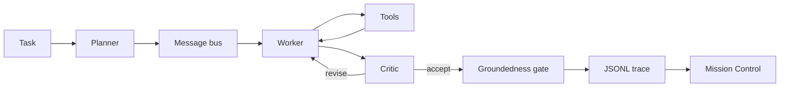

<video src="docs/mission-control.mp4" controls muted playsinline></video>

Orbit: Multi-Agent Mission Control runs a local planner, a worker, and a critic on questions a program can check.
The worker calls tools. The critic sends a bad claim back. A gate refuses anything the cited tool result does not contain.
Mission Control replays the JSONL trace from the engine, including a task you start on your own machine. A scripted-harness trace is labeled scripted harness.

## Try it yourself

Python 3.11 or newer. The demo target is an 8 GB machine with the 0.5B model. The 1.5B model is slow on that machine but can run in fp16; for a quicker loop stay on the 0.5B model or use Ollama on localhost. QLoRA and bitsandbytes are CUDA-only. `make setup` does not install them, and the demo never imports them. On MPS or CPU a saved adapter is merged in half precision or full precision. On CUDA, evaluation loads the base in 4-bit and attaches the adapter.

`make doctor` prints seconds for the scripted harness on the machine you run it on. `make doctor-live` downloads Qwen2.5-0.5B-Instruct and prints seconds for one real task. This page does not publish those readings.

### M1 Mac

```bash
python3 -m venv .venv
source .venv/bin/activate
make setup && make doctor
make doctor-live
make demo
```

`make doctor` should print `mps` when PyTorch can see the GPU, and `cpu` when it cannot. Open the localhost URL the server prints. Pick a bundled task id with the scripted harness, or type a question and choose Transformers. Ollama and llama.cpp are the other local backends. Ollama must stay on localhost. For llama.cpp, point `LLAMA_SERVER_URL` at a localhost OpenAI-compatible server; that server is the process that can use Metal.

### Linux

```bash
python3 -m venv .venv
source .venv/bin/activate
make setup && make doctor
make doctor-live
make demo
```

Without CUDA or MPS the device line is `cpu`. The same Mission Control page streams the run.

### Windows

`make` may be missing. From a Python 3.11 venv:

```bat
py -3.11 -m venv .venv
.venv\Scripts\activate
py -3.11 -m pip install -e ".[dev]" -r requirements-infer.txt
py -3.11 -m orbit_agents.doctor
py -3.11 -m orbit_agents.doctor --live
py -3.11 -m orbit_agents.serve
```

The Windows device is `cpu`. The Python tool still dies after one second; the limit is a child process, so it does not depend on a Unix alarm.

### What you should see

The scripted harness finishes a bundled task quickly enough that the doctor prints a fraction of a second or a few seconds, depending on the machine. A live 0.5B task is slower: the first run pays for the download, and the doctor is the measurement. Mission Control then shows the planner, the worker, a tool module docking on the worker, and the critic. The T+ column is a replay clock, not measured latency.

Troubleshooting:

- `torch is not installed` means `make setup` has not been run. QLoRA is still not required.
- `mps` missing on an M1 means the demo is on CPU. The 1.5B model is slow there; use the 0.5B model or Ollama if you want a shorter wait.
- A free-form question with the scripted harness returns an error. That backend only runs a bundled task id. Choose Transformers, Ollama, or llama.cpp for your own wording.
- GitHub Pages can host the `mission` directory and will replay the saved traces. The run form needs the local server.
- Out of memory: stay on the 0.5B default. Do not install bitsandbytes on a Mac to “make QLoRA work”; that stack is the Colab path below.

Pins for the demo live in `requirements-infer.txt`. The Colab training pins live in `finetune/requirements-colab.txt` and do not reinstall torch.

## Architecture



The tools are a sandboxed Python cell, a calculator, corpus file read, a per-run file write, keyword retrieval over the bundled notes, and an offline web cache. Nothing in the tool path opens a socket.

The corpus is a fictional makerspace: printers, a laser, and a shift sheet. Gold answers were computed by the checker and again by running the oracle snippet. The dev file trains and tunes. The test file stays frozen.

Flight rules, from the code the replay reads:

- The planner returns at most four steps, or an empty plan when the corpus cannot answer.
- The worker emits one tool call or a final answer. Every claim cites a tool result that contains it.
- The critic accepts grounded claims. Otherwise it revises, at most 2 times, and then the gate refuses unsupported claims.
- The team stops after 8 turns. A broken schema gets 2 tries on that turn.

## Replay

`mission/index.html` is static. It reads `mission/traces/*.jsonl`, which `python -m orbit_agents.trace` writes by running the engine. The bundled clips are `quotient.jsonl`, `abort.jsonl`, and `revise.jsonl`. Play, pause, scrub, and speed sit under the table. `prefers-reduced-motion` turns the pulses off.

`make demo` serves that page and `POST /api/run`. Events stream as they happen. The scripted harness will run a known task id. Your own question needs a local model. If the model stack is missing, the page shows the error instead of a made-up conversation.

Record the clip again with `python demo/record_replay.py`. It needs Chrome and ffmpeg.

## Fine-tune

Dialogues are built from the dev split and from the corpus tools: 307 train dialogues and 71 tune dialogues, covering the planner, the worker, and the critic. `finetune/leakage.py` rejects a test id, a test question, a near-duplicate question at ratio 0.9, a test answer string, or a test tool snippet. `finetune/train.py --dry-run` prints counts and does not claim a task score. Task iteration is `python -m orbit_agents.eval.run --split tune`. That split was not scored with a model here. This machine has no CUDA GPU, and the 1.5B model was not downloaded, so there is no tune-split number and no new frozen-test number in this change.

The Colab default is `finetune/configs/qlora_medium.json` (Qwen2.5-1.5B-Instruct, QLoRA). It targets a free T4 with 16 GB and about 60 minutes for training plus the three evals. That wall clock has not been measured here. `finetune/configs/qlora_small.json` is the 0.5B config used for the measured v1 run. `--method lora` is the MPS or CPU training path. On an M1, prefer that 0.5B config or Ollama; the 1.5B weights are slow but can run in fp16.

On a free T4, open `finetune/colab_train.ipynb` and run it from the top.

- Optional: set `ORBIT_MOUNT_DRIVE=1` before the first code cell to mount Drive. Otherwise checkpoints stay on the runtime disk under `/content/orbit-checkpoints`. Set `ORBIT_SAVE_DIR` to copy somewhere else as well.
- Upload the project zip to `/content/orbit.zip` to train that copy. With no zip, the notebook clones https://github.com/shmorsi/orbit-multi-agent. Set `REPO_URL` to clone a different remote instead.
- The install cell uninstalls torchao (the preinstalled build breaks `PeftModel.from_pretrained`), installs `finetune/requirements-colab.txt` with `--upgrade-strategy only-if-needed`, then `pip install -e . --no-deps`, and runs the leakage check in a subprocess. Do not reinstall torch. Pip output is not hidden.
- Train with `finetune/configs/qlora_medium.json`. The notebook copies the adapter, the loss curve, and `RUN.json` as soon as training returns.
- Score the frozen test once, and copy each file before the next command: single base, team base, team plus the adapter, then the comparison. CUDA loads the 1.5B base in 4-bit and attaches the adapter.
- Zip those files to `/content/outputs.zip` and download it.

Do not score the frozen test in a loop. A new model gets one frozen score. Iterate on the tune split, which this notebook does not run.

<!-- RESULTS_START -->
Measured once on the frozen test `team-eval-v1`, Qwen2.5-0.5B, QLoRA, 68 train dialogues and 23 tune dialogues. Files: `results/v1_qwen0.5b/`. Logged loss went from 1.3191939353942872 to 0.20024461746215821. This is the baseline. It is not a task-success win.

| Run | Successes | Schema-valid rate |
| --- | --- | --- |
| Single base | 2 of 12 | 0.0 |
| Team base | 2 of 12 | 0.07083333333333335 |
| Team plus adapter | 1 of 12 | 0.6131944444444445 |

The single-base rows have schema_valid 0 and n_tool_calls 0. The successes are the trap tasks (`n_correct_refusals` 2, then 2, then 1). No other task succeeded. The paired bootstrap interval for schema-valid rate, adapter minus team base, is 0.36388888888888893 to 0.7229166666666668 (point 0.5423611111111112). The same pair's task-success interval has high 0.0, so task success did not improve. Fine-tuning taught the format.

Single base, team base, team plus adapter, and the paired comparison for the new config are a pending run. The top-level files in `results/` stay pending until that one frozen score is written. A harness file in `results/` is a system check of the scripted tools, not a model score.
<!-- RESULTS_END -->

## What I built

The team loop, the six tools, the frozen split, the leakage check, the optional LoRA trainer, and Mission Control. The v1 QLoRA run above is the only measured model score. The 1.5B config, the larger dialogue set, and the harness repairs are in this tree, and they have not been scored on the frozen test.
