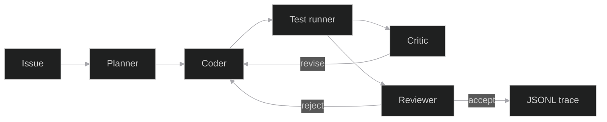
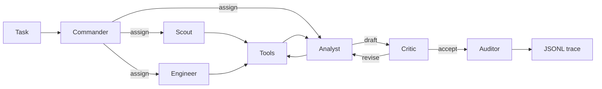

# Orbit

Planner, coder, tests, reviewer. A patch ships when the tests pass.

[](https://github.com/shmorsi/orbit-multi-agent/actions/workflows/ci.yml)
[](https://www.python.org/downloads/)
[](LICENSE)

[Mission Control](https://shmorsi.github.io/orbit/) · [Portfolio](https://shmorsi.github.io/) · [Key results](#key-results) · [Boardroom](#orbit-boardroom) · [Fine-tuning](#fine-tuning) · [Orbit Code](#orbit-code) · [Architecture](#architecture) · [Quickstart](#quickstart)

<p align="center">
  
</p>

The clip is a scripted demo. It follows an oracle on a toy bug. It is not the score. The table is the score.

## Key results

<!-- RESULTS_START -->
Orbit Code, frozen split `code-eval-v2`. A row is filled only from a measured file under `results/code_v2/`. Anything else is pending, not scored.

| Config | Model | pass@1 | Tests-passed rate | Reviewer rejections | Tokens | Cost USD |
| --- | --- | --- | --- | --- | --- | --- |
| Single agent | `claude-haiku-5-5` | 27 of 32 | 0.844 | 2 of 32 | 9250 in, 11494 out | 0.007 |
| Team with reviewer | `claude-haiku-5-5` | 29 of 32 | 0.906 | 1 of 32 | 37058 in, 29313 out | 0.018 |
| Single agent, local Qwen | pending | pending, not scored | | | | |

The paired bootstrap for pass@1, team with reviewer minus single agent, is 0.000 to 0.156 (point 0.063). That interval includes zero, so the difference is not significant. n is 32.

The earlier split `code-eval-v1` was scored and is superseded. The team pipeline refused a task when the planner reply failed the schema, and a critic accept stopped a red build before the coder could revise. Those files stay at `results/code/claude-haiku-5-5/` as the record of that run. They are not the current score.
<!-- RESULTS_END -->



## Orbit Boardroom

<p align="center">
  
</p>

Scripted demo on fictional data. Not a model score. CEO, CFO, CTO, and COO draft a launch memo. The auditor checks each claim against the files and refuses a revenue figure the CSV contradicts. The memo keeps only the claims the files support.

`make traces-boardroom` rewrites `mission/traces/boardroom/`.

## Fine-tuning

Archived v2 is the first table. The harness-v3 rescore follows it. A task-success interval that includes zero is not a significant difference.

<!-- FINETUNE_START -->
Rates, losses, and intervals below are the committed values, shown to three decimal places. The JSON files hold the full values.

Measured once on the frozen test `team-eval-v1`, Qwen2.5-1.5B-Instruct, QLoRA, 307 train dialogues and 71 tune dialogues. Files: `results/v2_qwen1.5b/`. Logged loss went from 1.152 at step 10 to 0.051 at step 150. Task success did not clear zero.

| Run | Successes | Task-success rate | Schema-valid rate | Trap refusals |
| --- | --- | --- | --- | --- |
| Single base | 2 of 12 | 0.167 | 0.750 | 2 of 2 |
| Team base | 2 of 12 | 0.167 | 0.607 | 2 of 2 |
| Team plus adapter | 3 of 12 | 0.250 | 0.780 | 1 of 2 |
| Team distill | not scored | | | |

The adapter's two answerable successes sit next to a missed trap: correct refusals went from 2 to 1. The paired bootstrap for task success, adapter minus team base, is -0.167 to 0.333 (point 0.083). That interval includes zero. The adapter is not separated from the base team on task success. The same pair's schema-valid interval is 0.001 to 0.339 (point 0.173). That interval is above zero. Schema-valid rate moved. Task success did not, on this 12-task set.


The earlier 0.5B run is in `results/v1_qwen0.5b/`. Successes were 2 of 12, 2 of 12, then 1 of 12, with schema-valid rates 0.000, 0.071, and 0.613. Logged loss went from 1.319 to 0.200. Its task-success interval also failed to clear zero. Fine-tuning taught the format.

The placeholder files at the top of `results/` stay pending. A harness file in `results/` is a system check of the scripted tools, not a model score. Team distill is a fourth config, scored only under harness v3 below.

The harness changed in v3. Search now lists tables and logs, python can read a bundled file by path, a count printed by python or equal to the matching lines in the cited text stays grounded, and the critic must return one JSON object. The v2 numbers above stay archived in `results/v2_qwen1.5b/`. single_base, team_base, team_lora, and team_distill were scored again on the frozen test under v3. Compare those four runs with each other. Do not compare them with the archived v2 numbers.

Harness v3, frozen test `team-eval-v1`, each run scored once. Files: `results/v3_qwen1.5b/`. This table is not a comparison with the archived v2 numbers.

| Run | Successes | Task-success rate | Schema-valid rate | Trap refusals |
| --- | --- | --- | --- | --- |
| Single base | 2 of 12 | 0.167 | 1.000 | 2 of 2 |
| Team base | 2 of 12 | 0.167 | 0.333 | 2 of 2 |
| Team plus adapter | 4 of 12 | 0.333 | 0.764 | 1 of 2 |
| Team distill | 2 of 12 | 0.167 | 0.448 | 2 of 2 |

The paired bootstrap for task success, team base minus single base, is 0.000 to 0.000 (point 0.000). That interval includes zero, so the difference is not significant. Its schema-valid interval is -0.844 to -0.490 (point -0.667). That interval excludes zero and is below zero. The paired bootstrap for task success, team plus adapter minus single base, is -0.167 to 0.500 (point 0.167). That interval includes zero, so the difference is not significant. Its schema-valid interval is -0.311 to -0.186 (point -0.236). That interval excludes zero and is below zero. The paired bootstrap for task success, team plus adapter minus team base, is -0.167 to 0.500 (point 0.167). That interval includes zero, so the difference is not significant. Its schema-valid interval is 0.264 to 0.607 (point 0.431). That interval excludes zero and is above zero. The paired bootstrap for task success, team distill minus single base, is 0.000 to 0.000 (point 0.000). That interval includes zero, so the difference is not significant. Its schema-valid interval is -0.642 to -0.437 (point -0.552). That interval excludes zero and is below zero. The paired bootstrap for task success, team distill minus team base, is 0.000 to 0.000 (point 0.000). That interval includes zero, so the difference is not significant. Its schema-valid interval is -0.064 to 0.278 (point 0.115). That interval includes zero, so the difference is not significant. The paired bootstrap for task success, team distill minus team plus adapter, is -0.500 to 0.167 (point -0.167). That interval includes zero, so the difference is not significant. Its schema-valid interval is -0.401 to -0.209 (point -0.316). That interval excludes zero and is below zero.

The round-table team is not scored.

API policy `claude-haiku-5-5`, harness v3, frozen test `team-eval-v1`, each team scored once with the same model and role prompts only. Files: `results/v3_api/claude-haiku-5-5/`.

| Run | Successes | Task-success rate | Schema-valid rate | Trap refusals |
| --- | --- | --- | --- | --- |
| v1 team (3 roles) | 1 of 12 | 0.083 | 0.862 | 1 of 2 |
| v2 team (6 roles) | 0 of 12 | 0.000 | 0.559 | 0 of 2 |
| Round-table team | not scored | | | |

The paired bootstrap for task success, v2 team minus v1 team, is -0.250 to 0.000 (point -0.083). That interval includes zero. Its schema-valid interval is -0.425 to -0.174 (point -0.303). That interval is below zero.

Pending slots. A row here is not a result. The round table stays here until a measured file exists.

| Slot | File | Status |
| --- | --- | --- |
| Claude policy, round table, harness v3 | `results/v3_api/<model>/team_v3.json` | pending |
<!-- FINETUNE_END -->

## Orbit Code

Planner, coder, test runner, reviewer. The coder edits a temp workspace. The test runner executes pytest there with a timeout and no network. The reviewer rejects a patch whose tests fail or whose diff touches the tests. A critic can send the coder back. A grounding gate drops a "tests passed" claim the run does not support.

The frozen split to score is `data/scenarios/code_v2/`, protocol `code-eval-v2`, with hidden tests the prompt never sees. `python -m orbit_agents.eval.score_code` checks that manifest hash and, when the git tag exists, the tag. It refuses to overwrite a measured file. `data/scenarios/code/` is the earlier split. Its measured files under `results/code/claude-haiku-5-5/` stay as the record of a run the team harness invalidated. They are not the current score.

| Config | What runs |
| --- | --- |
| `single` | One coder turn, then the test runner and the reviewer |
| `team` | Planner, coder, test runner, critic, and the reviewer, with revise passes |

A local Qwen run uses the transformers policy that is already in the repo. Dry-run does not load the weights.

```bash
python -m orbit_agents.eval.score_code --config team --provider anthropic --model claude-haiku-5-5 --dry-run
python -m orbit_agents.eval.score_code --config single --provider anthropic --model claude-haiku-5-5 --dry-run
python -m orbit_agents.eval.score_code --config single --provider transformers --model Qwen/Qwen2.5-1.5B-Instruct --dry-run
```

Dry-run prints the request bound and the cost cap. It does not read a key and it writes nothing. The cap is the distillation cost stop. The price table is the one in `finetune/distill_teacher.py`. Transport retries, including a read timeout, count toward the request cap.

```bash
export ORBIT_ANTHROPIC_API_KEY=your-key
python -m orbit_agents.eval.score_code --config team --provider anthropic --model claude-haiku-5-5
python -m orbit_agents.eval.score_code --config single --provider anthropic --model claude-haiku-5-5
python -m orbit_agents.eval.readme
```

Those commands write `results/code_v2/<model>/team.json` and `results/code_v2/<model>/single.json`. A file that is already measured is left in place. The local Qwen row stays pending until that file exists. A `code-eval-v1` file that is already measured is left in place.

`make traces-code` rewrites the scripted Mission Control traces: one repair, and one patch the reviewer rejects because it edits a test.

## Incident commander

<p align="center">
  
</p>

The clip is a scripted demo. The corpus is fictional. Orbit Code is the headline. The fine-tuning numbers are in the section above, not in this outage.

## Why this matters

Hiring teams want an agent that edits code, runs the tests, and does not ship a red build. Orbit Code is that loop, small enough to read. The boardroom demo uses the same rule: a claim stays only when the file states it.

The code-eval-v2 score is in Key results. The pass@1 interval includes zero, so the team is not separated from the single agent on that split. Fine-tuning on the makerspace corpus taught the format. Its task-success intervals include zero. Those files stay in `results/v2_qwen1.5b/` and `results/v3_qwen1.5b/`.

## Architecture

<p align="center">
  
</p>

<p align="center">
  
</p>

`docs/build_figures.py` draws both pictures from the measured files and the engine constants.

**Planner.** One JSON object. The steps say what to change. The planner does not edit files.

**Coder.** One JSON object: full file contents, source only.

**Test runner.** Pytest in the temp workspace. Timeout. No network.

**Critic.** One JSON object. Accept, or send the draft back.

**Reviewer.** Code, not a model turn. It rejects a failing run and any diff that touches a test.

**Grounding gate.** A tests-passed claim stays only when pytest passed and the reviewer accepted.


<video src="docs/mission-control.mp4" controls muted playsinline aria-label="Mission Control replaying a saved trace, stepping through planner, worker, tool, and critic"></video>


## Quickstart

Python 3.11 or newer. These commands install the harness, time one scripted task, and run the suite. They do not download a model and they do not score a frozen test.

```bash
python3 -m venv .venv
source .venv/bin/activate
python -m pip install -e ".[dev]"
python -m orbit_agents.doctor
python -m pytest
```

`python -m orbit_agents.doctor` prints JSON. `scripted.ok` is true and `scripted.kind` is `scripted_harness`. That is a harness check, not a model score. `pytest` includes the check that the results block matches the files.

Mission Control on this machine:

```bash
python -m orbit_agents.serve
```

`make setup` also installs the demo stack, then `make test` runs the suite and `make demo` opens the same page. Open the localhost URL the server prints. The scenario switcher covers Code, Boardroom, and Incident. Platform notes are in [Run it locally](#run-it-locally). The development notes, including what not to edit, are in [docs/DEVELOPMENT.md](docs/DEVELOPMENT.md).


## v2: six roles

`--team v2` runs the same tasks, tools, and grounding gate with six seats instead of three. `--team v1` stays the default. The six-role API score is in Fine-tuning. It is not the Orbit Code score.



| Role | Tools | Can answer |
| --- | --- | --- |
| Commander | none; assigns each step to one specialist | no |
| Scout | retrieve, read_file, web_search | no |
| Engineer | python, write_file | no |
| Analyst | calculator | yes, the only seat that drafts the final |
| Critic | none | no; accepts or sends the draft back, at most 2 times |
| Auditor | none; read-only copy of the trace | no; refuses any claim or number the tool results do not support |

- Every turn is one JSON object checked against that role's schema. A tool outside the role's list fails validation and never runs.
- The auditor is code, not a model turn. Its verdict is the v1 grounding gate, and it writes one finding per claim and per number into the trace.
- The limits are the v1 limits: 8 turns, 2 revise passes, and 2 schema tries on a turn.
- Every seat calls one interface, `LLMClient.complete(messages, schema)`, in `src/orbit_agents/policy.py`. Backends: scripted, transformers, ollama, llama.cpp, and anthropic. Adding a provider is one class; `OpenAICompatiblePolicy` is the documented stub.
- The policy sees only the role prompts and the task. It never sees the checker contract the distillation teacher gets, or any frozen-test content.

Offline, with the scripted harness (a harness check, not a model score):

```bash
python -m orbit_agents.eval.run --team v2 --split test --out traces/v2_check.json
make traces-v2   # rewrites mission/traces/v2: accept, revise, and an auditor refusal
```

With Claude as the policy for both teams, so v1 and v2 are compared on the same model:

```bash
make score-dry-run MODEL=claude-haiku-5-5          # checks the frozen test hash and tag, prints the request bound
export ORBIT_ANTHROPIC_API_KEY=your-key
make score-v1 MODEL=claude-haiku-5-5
make score-v2 MODEL=claude-haiku-5-5
```

Each target scores the frozen test once and writes `results/v3_api/<model>/team_v1.json` or `team_v2.json`. It refuses a config that is already measured. The request cap and the 5 USD cost stop are the distillation script's. When both files are measured, the paired bootstrap of v2 minus v1 is written next to them, and the README generator adds the rows below. Those two files for this model are measured. The rows are in Key results. `make score-v2` refuses a second run.

If `ORBIT_ANTHROPIC_API_KEY` and `ANTHROPIC_API_KEY` are both unset, `make score-v1` and `make score-v2` exit before any request and name `ORBIT_ANTHROPIC_API_KEY`. Nothing is read from a file. `make score-dry-run` does not read a key.

## Round table

The round table keeps the six seats and adds a coordinator, a researcher, a red team, and a verifier. It does not change the v1 or v2 prompts, the frozen test, or the archived scores. The researcher takes the first read. The red team's claim is checked in code and is not merged into the draft the auditor scores. The specialist turn limit is unchanged.

Open Mission Control and choose a trace under Round table. Messages draw as links between seats. A refusal lights the ring and the page says why, in the words above.

Offline, the scripted harness solves the tasks. That run is a system check, not a model score:

```bash
python -m orbit_agents.eval.run --team v3 --split test --out traces/v3_check.json
make traces-v3
```

The model score is one API run. It is pending until this file exists and is measured:

```bash
make score-dry-run MODEL=claude-haiku-5-5
export ANTHROPIC_API_KEY=your-key
make score-v3 MODEL=claude-haiku-5-5
```

`make score-v3` also accepts `ORBIT_ANTHROPIC_API_KEY`. It writes `results/v3_api/<model>/team_v3.json` and refuses a file that is already measured. The generator then fills the round-table row. Until that file is measured, the Key results block says the round-table team is not scored, with no number filled in. Harness v3, the tool and gate change described in that block, is a different thing from this team. The model card is [docs/MODEL_CARD.md](docs/MODEL_CARD.md). The eval write-up is [docs/EVAL.md](docs/EVAL.md).

## Reproducibility and integrity

- The frozen test is `eval/test.jsonl`, tagged `team-eval-v1`. Its digest is stored in `eval/manifest.json`. `make score-dry-run` checks the file and the tag, reads no API key, and writes nothing.
- `python finetune/leakage.py` fails if a frozen task, a near-duplicate, or an oracle call appears in train or tune.
- `python -m orbit_agents.eval.readme --check` fails if the Key results block disagrees with `results/`. The test suite runs that check.
- A config is scored once. `eval.run` and `eval.compare` refuse archived files, harness checks, the pending placeholders, and a second score of a measured frozen-test file.
- Files at the top of `results/` with status pending are not model scores. `results/harness_single.json` and `results/harness_team.json` replay the scripted harness. They are system checks.
- The manifest also stores a prompt digest from the protocol freeze. Later harness work changed the role prompts. The scorer checks the frozen test and the tag. This page does not treat that prompt digest as a current hash of the prompts.
- An earlier Claude score crashed on a socket read timeout, wrote no score file, and was rerun from scratch after the transport began returning that timeout as a retryable server error.
- Cite the project with [CITATION.cff](CITATION.cff).

## What I'd do next

Future work, not a claim about a result:

- Score the local Qwen row on `code-eval-v2` once and let the generator fill it. The `claude-haiku-5-5` rows are already measured. Dry-run first. It prints the request bound and the cost cap.
- Score the round table once with `make score-v3` and let the generator add that row. The three-role and six-role API scores are already measured.
- Keep the archived v2 numbers in `results/v2_qwen1.5b/`. The harness-v3 rescore, including team distill, is a separate table.
- Train more than one seed before talking about a distribution. This page has one training run per config.

## Limitations

- Orbit Code on `code-eval-v2` was scored once per config. The pass@1 interval includes zero, so that difference is not significant. The lead clip is a scripted demo. The coder returns full file contents for short modules. It is not a repo-scale software engineer. The earlier split is superseded because the team harness stopped a red build before the coder could revise, and that record is not the current score.
- The Boardroom clip is a scripted demo on fictional files. It is not a score and it is not advice.
- The frozen test is 12 tasks, 2 of them traps. One task moves a rate by a twelfth, so only large effects can clear zero.
- Each model was trained once and scored once. There is no seed sweep.
- The adapter that added a success also missed a trap: correct refusals went from 2 to 1.
- The harness changed in v3. The archived Qwen numbers stay in their own table. The harness-v3 rescore is in Key results. A task-success interval that includes zero is not a significant difference.
- Team distill is scored under harness v3. The notebook below is how that run was produced.
- The six-role API score is in Key results. The traces in `mission/traces/v2/` still come from the scripted harness, which follows each task's oracle; they show the protocol, separate from that score.
- The round-table team has not been scored. Its traces in `mission/traces/v3/` are the same kind of harness replay.
- The free-T4 wall clock for training plus scoring has not been measured.

## Distillation

The templated 307 dialogs taught the JSON shape and not the counting. `finetune/distill_teacher.py` asks a teacher model to act as planner, worker, and critic on train and tune tasks only. Each tool call runs in Orbit's sandbox. A trajectory is kept only when the task checker passes and every turn matches the role schema. Trap tasks stay in the pool so a correct refusal can be kept. The generator adds count, sum, threshold, log, quotient, write, and refusal variants on top of the 69 templated train tasks. Gemini and Claude write the same dialog files. Each kept dialog records the teacher model in its metadata, and `stats.json` records it too.

The frozen test is a local blocklist. Its ids, questions, near-duplicates, distinctive fragments, and oracle calls are not placed in a request and are not written as rows. `--dry-run` prints the pool and does not read an API key.

Cost controls:

- The hard cap defaults to 800 requests for this run. The checkpoint still records the running total. A restart is not blocked by that total unless you also set `--max-total-requests`.
- With `--provider gemini`, the client waits so the pace stays near 4 requests per minute. Each request log prints that configured rate, the effective rate since the run started, and the count per status code.
- The first request is a preflight with no task text. A client error there exits before any task is sent.
- HTTP 503 waits 20 seconds, then 40, then 80. Each of those retries counts toward the cap. After that the process stops.
- A per-minute HTTP 429 whose stated retry delay is 120 seconds or less waits that long once and continues. A per-day quota, a longer delay, or a second consecutive 429 stops the process and writes the checkpoint.
- Any other client error stops the process on that response. The run does not send another request.
- Another server error is tried up to 3 times, then the process stops.
- A model whose name starts with gemma does not receive a system instruction field. That text is placed in the first user turn.
- Token counts and the request total are printed as JSON lines.
- If the Google project has billing turned on, successful calls can still incur charges up to the cap. Confirm billing is off before you export the key.

```bash
python finetune/distill_teacher.py --dry-run
export ORBIT_ANTHROPIC_API_KEY=your-key
python finetune/distill_teacher.py \
  --provider anthropic \
  --model claude-haiku-5-5 \
  --max-requests 800 \
  --requests-per-minute 20 \
  --max-cost-usd 5 \
  --attempts 3 \
  --output finetune/data/distill
```

The default provider is Anthropic and the default model is `claude-haiku-5-5`. A name that starts with `claude` selects Anthropic even without `--provider`. `--model` also accepts the Sonnet and Opus ids in the price table. The Anthropic key is read from `ORBIT_ANTHROPIC_API_KEY`. Requests omit temperature unless you pass `--temperature`. The reply is taken from text blocks only. The teacher prompt includes the final-answer JSON and the tool-call JSON the checker scores, including the claim names for that task. Pass `--families` and `--limit-tasks` to try a few tasks, and `--debug-dir` to keep every attempt. The pace defaults to 20 requests per minute. Request logs include input tokens, output tokens, and a running cost estimate in USD. The estimate uses the price table in `finetune/distill_teacher.py`. The same table is recorded in `finetune/configs/qlora_distill.json`. An unknown model uses the fallback price, 15 dollars per million input tokens and 75 dollars per million output tokens, so the cost limit cannot be under-counted. At 5 USD the run stops and writes the checkpoint. A response that says the credit balance is too low, or any other billing error, stops the same way. HTTP 429 and overloaded or other server errors wait 20 seconds, then 40, then 80, and each retry counts toward the cap. Any other client error stops on that response.

Gemini is still available. Pass `--provider gemini` and set `ORBIT_TEACHER_API_KEY`. That path keeps the free-tier pace of 4 requests per minute and does not apply the dollar limit. A stopped run resumes from `finetune/data/distill/checkpoint.json`. The kept dialogs are `train.jsonl` and `tune.jsonl` in that directory, in the same message format as the templated set, plus `stats.json` with attempts and pass rate per task family.

Train the student with `finetune/configs/qlora_distill.json`. That config sets `max_seq_length` to 1536. The trainer refuses a shorter cap, because truncation drops the assistant turn and leaves the assistant mask empty. In Colab, set `ORBIT_DISTILL=1` before the distillation cell in `finetune/colab_train.ipynb`. That cell trains the distill config and scores `team_distill` once. The harness is now v3, so a fair comparison needs a fresh score of single_base, team_base, team_lora, and team_distill on the frozen test. Set `ORBIT_RESCORE=1` before the rescore cell. That cell does not train. It writes the four scores once under `results/v3_qwen1.5b/`. The v2 numbers stay archived in `results/v2_qwen1.5b/`. The comparison adds the distill pairs only when that file is present. Do not score the frozen test in a loop.

## Run it locally

Python 3.11 or newer. The demo target is an 8 GB machine with the 0.5B model. The 1.5B model is slow on that machine but can run in fp16. QLoRA and bitsandbytes are CUDA-only. `make setup` does not install them, and the demo never imports them.

`make doctor` prints seconds for the scripted harness on the machine you run it on. `make doctor-live` downloads Qwen2.5-0.5B-Instruct and prints seconds for one real task. This page does not publish those readings.

### M1 Mac

```bash
python3 -m venv .venv
source .venv/bin/activate
make setup && make doctor
make doctor-live
make demo
```

`make doctor` should print `mps` when PyTorch can see the GPU, and `cpu` when it cannot. Open the localhost URL the server prints. Pick a bundled task id with the scripted harness, or type a question and choose Transformers.

### Linux

```bash
python3 -m venv .venv
source .venv/bin/activate
make setup && make doctor
make doctor-live
make demo
```

Without CUDA or MPS the device line is `cpu`. The same Mission Control page streams the run.

### Windows

`make` may be missing. From a Python 3.11 venv:

```bat
py -3.11 -m venv .venv
.venv\Scripts\activate
py -3.11 -m pip install -e ".[dev]" -r requirements-infer.txt
py -3.11 -m orbit_agents.doctor
py -3.11 -m orbit_agents.doctor --live
py -3.11 -m orbit_agents.serve
```

The Windows device is `cpu`. The Python tool still dies after one second; the limit is a child process.

### What you should see

Mission Control shows the planner, the worker, a tool call in the telemetry strip, and the critic. The phase rail steps Planner, Worker, Tool, Critic. The Trace menu also lists the six-role traces under Team v2; choosing one switches the ring to those six seats and the rail to Commander, Specialist, Tool, Critic, and Auditor. Under the replay, the flight-data wall charts the archived v2 1.5B run with bootstrap intervals, the loss curve, the trap outcomes, and an empty slot for team distill. The harness-v3 scores, including team distill, are in Key results. The T+ column is a replay clock, not measured latency.

`mission/index.html` is static. GitHub Pages can host the `mission` directory, and the same files open under `make demo`. The run form needs the local server. `prefers-reduced-motion` turns the pulses off.

Record the clip again with `python demo/record_replay.py`. It needs Chrome and ffmpeg.

Troubleshooting:

- `torch is not installed` means `make setup` has not been run. QLoRA is still not required.
- `mps` missing on an M1 means the demo is on CPU. The 1.5B model is slow there; use the 0.5B model or Ollama if you want a shorter wait.
- A free-form question with the scripted harness returns an error. That backend only runs a bundled task id.
- Out of memory: stay on the 0.5B default. Do not install bitsandbytes on a Mac to make QLoRA work. That stack is the Colab path.

Pins for the demo live in `requirements-infer.txt`. The Colab training pins live in `finetune/requirements-colab.txt` and do not reinstall torch.

## Fine-tune

On a free T4, open `finetune/colab_train.ipynb` and run it from the top.

[](https://colab.research.google.com/github/shmorsi/orbit-multi-agent/blob/main/finetune/colab_train.ipynb)

The default cell trains `finetune/configs/qlora_medium.json` (Qwen2.5-1.5B-Instruct, QLoRA). It targets a free T4 with 16 GB and about 60 minutes for training plus the three evals. That wall clock has not been measured here.

- Optional: set `ORBIT_MOUNT_DRIVE=1` before the first code cell to mount Drive. Otherwise checkpoints stay on the runtime disk under `/content/orbit-checkpoints`.
- Upload the project zip to `/content/orbit.zip` to train that copy. With no zip, the notebook clones https://github.com/shmorsi/orbit-multi-agent.
- The install cell uninstalls torchao, installs `finetune/requirements-colab.txt` with `--upgrade-strategy only-if-needed`, then `pip install -e . --no-deps`, and runs the leakage check.
- Score the frozen test once into `results/v3_qwen1.5b/`: single base, team base, team plus the adapter, then the comparison. A file that is already measured is skipped. These cells do not replace the pending files at the top of `results/`. Set `ORBIT_DISTILL=1` only when the distilled JSONL is in the zip. That adds `team_distill` under the same directory and does not repeat the three scores.
- The notebook then runs `python -m orbit_agents.eval.readme`, which rewrites the results block from those files. Zip the run to `/content/outputs.zip` and download it. Commit `results/v3_qwen1.5b/*.json` and `README.md` only.

`finetune/configs/qlora_small.json` is the 0.5B config from the measured v1 run. `--method lora` is the MPS or CPU training path. On an M1, prefer that 0.5B config or Ollama.

Do not score the frozen test in a loop. A new model gets one frozen score. Iterate on the tune split with `python -m orbit_agents.eval.run --split tune`.

### Distill and score in one notebook

[](https://colab.research.google.com/github/shmorsi/orbit-multi-agent/blob/main/notebooks/run_distill_and_score.ipynb)

[`notebooks/run_distill_and_score.ipynb`](notebooks/run_distill_and_score.ipynb) runs the team-distill path end to end on a free T4: the Claude teacher (`claude-haiku-5-5` by default, `claude-sonnet-5-5` as an option) under the same request cap and cost stop, QLoRA with `finetune/configs/qlora_distill.json`, one frozen score into `results/v3_qwen1.5b/team_distill.json`, the v3 baselines it needs (each once, skipped if present), the paired comparison, and a regenerated README results block. Add the key as a Colab secret named `ORBIT_ANTHROPIC_API_KEY` before running. It is read from secrets or the environment and never printed. If the secret and the environment variable are both missing, the key cell exits and names `ORBIT_ANTHROPIC_API_KEY`. The download keeps `results/v3_qwen1.5b/*.json` and `README.md` at those paths. Commit only those files.

The results block above is written by `python -m orbit_agents.eval.readme` from the files in `results/`. `--check` fails when the README and the files disagree, and the test suite runs that check.
