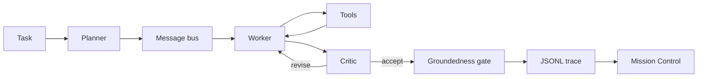

<video src="docs/mission-control.mp4" controls muted playsinline></video>

Orbit: Multi-Agent Mission Control runs a local planner, a worker, and a critic on questions a program can check.
The worker calls tools. The critic sends a bad claim back. A gate refuses anything the cited tool result does not contain.
Mission Control replays the JSONL trace from the engine, including a task you start on your own machine. A scripted-harness trace is labeled scripted harness.

## Try it yourself

Python 3.11 or newer. The demo target is an 8 GB machine with the 0.5B model. The 1.5B model is optional and tight on that machine. QLoRA and bitsandbytes are CUDA-only. `make setup` does not install them, and the demo never imports them. A saved adapter, if you have one, is merged in half precision on MPS or CUDA and in full precision on CPU.

`make doctor` prints seconds for the scripted harness on the machine you run it on. `make doctor-live` downloads Qwen2.5-0.5B-Instruct and prints seconds for one real task. This page does not publish those readings.

### M1 Mac

```bash
python3 -m venv .venv
source .venv/bin/activate
make setup && make doctor
make doctor-live
make demo
```

`make doctor` should print `mps` when PyTorch can see the GPU, and `cpu` when it cannot. Open the localhost URL the server prints. Pick a bundled task id with the scripted harness, or type a question and choose Transformers. Ollama and llama.cpp are the other local backends. Ollama must stay on localhost. For llama.cpp, point `LLAMA_SERVER_URL` at a localhost OpenAI-compatible server; that server is the process that can use Metal.

### Linux

```bash
python3 -m venv .venv
source .venv/bin/activate
make setup && make doctor
make doctor-live
make demo
```

Without CUDA or MPS the device line is `cpu`. The same Mission Control page streams the run.

### Windows

`make` may be missing. From a Python 3.11 venv:

```bat
py -3.11 -m venv .venv
.venv\Scripts\activate
py -3.11 -m pip install -e ".[dev]" -r requirements-infer.txt
py -3.11 -m orbit_agents.doctor
py -3.11 -m orbit_agents.doctor --live
py -3.11 -m orbit_agents.serve
```

The Windows device is `cpu`. The Python tool still dies after one second; the limit is a child process, so it does not depend on a Unix alarm.

### What you should see

The scripted harness finishes a bundled task quickly enough that the doctor prints a fraction of a second or a few seconds, depending on the machine. A live 0.5B task is slower: the first run pays for the download, and the doctor is the measurement. Mission Control then shows the planner, the worker, a tool module docking on the worker, and the critic. The T+ column is a replay clock, not measured latency.

Troubleshooting:

- `torch is not installed` means `make setup` has not been run. QLoRA is still not required.
- `mps` missing on an M1 means the demo is on CPU. Close other apps before trying the 1.5B model.
- A free-form question with the scripted harness returns an error. That backend only runs a bundled task id. Choose Transformers, Ollama, or llama.cpp for your own wording.
- GitHub Pages can host the `mission` directory and will replay the saved traces. The run form needs the local server.
- Out of memory: stay on the 0.5B default. Do not install bitsandbytes on a Mac to “make QLoRA work”; that stack is the Colab path below.

Pins for the demo live in `requirements-infer.txt`. The Colab training pins live in `finetune/requirements-colab.txt` and do not reinstall torch.

## Architecture



The tools are a sandboxed Python cell, a calculator, corpus file read, a per-run file write, keyword retrieval over the bundled notes, and an offline web cache. Nothing in the tool path opens a socket.

The corpus is a fictional makerspace: printers, a laser, and a shift sheet. Gold answers were computed by the checker and again by running the oracle snippet. The dev file trains and tunes. The test file stays frozen.

Flight rules, from the code the replay reads:

- The planner returns at most four steps, or an empty plan when the corpus cannot answer.
- The worker emits one tool call or a final answer. Every claim cites a tool result that contains it.
- The critic accepts grounded claims. Otherwise it revises, at most 2 times, and then the gate refuses unsupported claims.
- The team stops after 8 turns. A broken schema gets 2 tries on that turn.

## Replay

`mission/index.html` is static. It reads `mission/traces/*.jsonl`, which `python -m orbit_agents.trace` writes by running the engine. The bundled clips are `quotient.jsonl`, `abort.jsonl`, and `revise.jsonl`. Play, pause, scrub, and speed sit under the table. `prefers-reduced-motion` turns the pulses off.

`make demo` serves that page and `POST /api/run`. Events stream as they happen. The scripted harness will run a known task id. Your own question needs a local model. If the model stack is missing, the page shows the error instead of a made-up conversation.

Record the clip again with `python demo/record_replay.py`. It needs Chrome and ffmpeg.

## Fine-tune

Dialogues come from the dev split only. `finetune/leakage.py` rejects a test id, a test question, or a test tool snippet in those files. `finetune/train.py --dry-run` prints counts and does not claim a task score.

On a free T4, open `finetune/colab_train.ipynb` and run it from the top.

- Upload the project zip to `/content/orbit.zip` to train that copy. The setup cells unzip it into `/content/orbit` and check that the config is the 0.5B QLoRA file.
- With no zip, those cells clone https://github.com/shmorsi/orbit-multi-agent. Set `REPO_URL` to clone a different remote instead.
- Install `finetune/requirements-colab.txt` with `--upgrade-strategy only-if-needed`, then `pip install -e . --no-deps`, and run the leakage check. Do not reinstall torch.
- Train with `finetune/configs/qlora_small.json`.
- Display the loss curve the trainer wrote.
- Score the frozen test once: single base, team base, team plus the adapter. Then compare those three files.
- Zip the adapter, the loss curve, `RUN.json`, and the result files to `/content/outputs.zip` and download it.

Do not score the frozen test in a loop. `--method lora` is the MPS or CPU training path when you are not on the T4. The notebook does not use the 1.5B config.

<!-- RESULTS_START -->
| Run | State |
| --- | --- |
| Single base model | pending run |
| Team, base model | pending run |
| Team plus adapter | pending run |
| Paired comparison | pending run |

No language-model score has been measured. The metrics fields are null. A harness file in `results/` is a system check of the scripted tools, not a model score.
<!-- RESULTS_END -->

## What I built

The team loop, the six tools, the frozen split, the leakage check, the optional LoRA trainer, and Mission Control. I did not run QLoRA or the three model evals here, so the table above stays a pending run until those commands write measured files.
