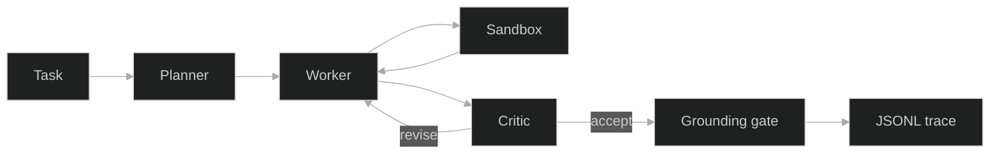
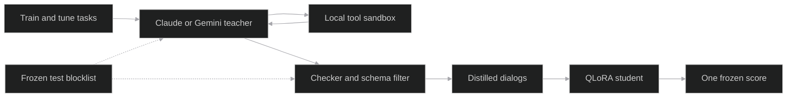
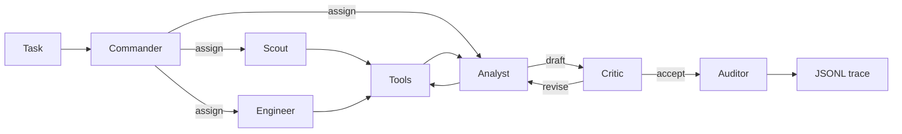

# Orbit

An autonomous incident commander: a local crew that writes the checkout-outage report only when the logs, the metrics, and the runbook support every claim.

[](https://github.com/shmorsi/orbit-multi-agent/actions/workflows/ci.yml)
[](https://www.python.org/downloads/)
[](LICENSE)

[Mission Control](https://shmorsi.github.io/orbit/) · [Portfolio](https://shmorsi.github.io/) · [Architecture](#architecture) · [Key results](#key-results) · [Six roles](#v2-six-roles) · [Round table](#round-table) · [Quickstart](#quickstart) · [Integrity](#reproducibility-and-integrity)

<p align="center">
  
</p>

The clip is a scripted demo. The corpus is fictional. Every measured number on this page comes from the frozen makerspace test, not from this outage.

<p align="center">
  
</p>

| | |
| --- | --- |
| **What it is** | The featured replay is an incident commander on a fictional checkout outage: commander, engineer, critic, and a code gate. It is a scripted harness following the oracle, not a model score. The measured runs are three roles on the makerspace corpus. The planner writes at most four steps. The worker calls one sandboxed tool or states a final answer. The critic accepts the claim or sends it back. A grounding gate drops anything the tool results do not support. |
| **Why it matters** | A tool-calling model can emit valid JSON and still invent the number. Orbit separates those two failures and scores them once on a frozen test. The page reports what landed, including the comparison that did not clear zero. |
| **Key results** | QLoRA on Qwen2.5-1.5B moved the schema-valid rate from 0.607 to 0.780, shown to three decimal places. That paired interval is above zero. Task success went from 2 of 12 to 3 of 12, and that paired interval includes zero, so the adapter is not separated from the base team on task success. Claude score-v1, Claude score-v2, the round table, and the T4 distill run are pending. |

Fine-tuning taught the format. It did not separate the runs on task success. The files in `results/v2_qwen1.5b/` hold the full values. The diagram below is the measured three-role team. `docs/build_figures.py` draws the hero from those files.



## Quickstart

Python 3.11 or newer. These commands install the harness, time one scripted task, and run the suite. They do not download a model and they do not score the frozen test.

```bash
python3 -m venv .venv
source .venv/bin/activate
python -m pip install -e ".[dev]"
python -m orbit_agents.doctor
python -m pytest
```

`python -m orbit_agents.doctor` prints JSON. `scripted.ok` is true and `scripted.kind` is `scripted_harness`. That is a harness check, not a model score. `pytest` includes the check that the results block matches the files.

Mission Control on this machine:

```bash
python -m orbit_agents.serve
```

`make setup` also installs the demo stack, then `make test` runs the suite and `make demo` opens the same page. Open the localhost URL the server prints. Pick a bundled task id for the scripted harness. A free-form question needs a model backend. Platform notes are in [Run it locally](#run-it-locally). The development notes, including what not to edit, are in [docs/DEVELOPMENT.md](docs/DEVELOPMENT.md).

## Why this matters

Checkout is failing. The commander assigns the steps. The engineer counts the log lines in code. A red team blames the inventory service. The code gate refuses that root cause because the cited tool result does not support it, and the auditor keeps only the claims the files actually contain. That is the incident commander. The files are a made-up night, and the replay follows the oracle. It shows the protocol. It is not a model score.

Hiring teams want an agent that uses tools and stops when the evidence runs out. Orbit is a small, fully inspectable version of that problem. Every seat returns one JSON object. The tools are sandboxed and nothing in that path opens a socket. A critic can send a claim back. A gate keeps a claim only when the cited tool result contains it, a python call printed it, or it equals a count of matching lines in the cited text.

The frozen test is hashed, tagged, and kept out of training. Each model is scored once, with a paired bootstrap, and a comparison that includes zero stays on the page. The measured 1.5B QLoRA run learned the answer format. On the frozen 12-task test the paired interval for task success includes zero. That is the result.

## Architecture

<p align="center">
  
</p>

The measured numbers on this page are the three-role team, harness v2, archived in `results/v2_qwen1.5b/`. The picture is drawn by `docs/build_figures.py` from those files and from the constants in the engine. It is not a stock image.

**Planner.** One JSON object. At most four steps, or an empty plan when the corpus cannot answer.

**Worker.** One JSON object: a tool call, or a final answer with claims. Each claim cites a tool result.

**Critic.** One JSON object. It accepts a grounded claim or sends the draft back, at most 2 times.

**Grounding gate.** Code, not another model turn. A claim stays when the cited tool result contains it, when a python call printed the count, or when the count equals the number of matching lines in the cited text. Otherwise the gate refuses the claim.

**Sandbox.** The worker may call `calculator`, `read_file`, `write_file`, `python`, `retrieve`, or `web_search`. `web_search` reads a bundled cache. Nothing in the tool path opens a socket. The Python tool runs in a child process and is killed after one second.

The team stops after 8 turns. A broken schema gets 2 tries on that turn. Mission Control replays the JSONL trace, including a task you start on your own machine.

The teacher pass sits beside that loop. It never sees the frozen test.



## Key results

This block is written by `python -m orbit_agents.eval.readme` from the files in `results/`. API scores and team distill are pending. A pending run is a row that says not scored, with no number filled in.

<!-- RESULTS_START -->
Rates, losses, and intervals below are the committed values, shown to three decimal places. The JSON files hold the full values.

Measured once on the frozen test `team-eval-v1`, Qwen2.5-1.5B-Instruct, QLoRA, 307 train dialogues and 71 tune dialogues. Files: `results/v2_qwen1.5b/`. Logged loss went from 1.152 at step 10 to 0.051 at step 150. Task success did not clear zero.

| Run | Successes | Task-success rate | Schema-valid rate | Trap refusals |
| --- | --- | --- | --- | --- |
| Single base | 2 of 12 | 0.167 | 0.750 | 2 of 2 |
| Team base | 2 of 12 | 0.167 | 0.607 | 2 of 2 |
| Team plus adapter | 3 of 12 | 0.250 | 0.780 | 1 of 2 |
| Team distill | not scored | | | |

The adapter's two answerable successes sit next to a missed trap: correct refusals went from 2 to 1. The paired bootstrap for task success, adapter minus team base, is -0.167 to 0.333 (point 0.083). That interval includes zero. The adapter is not separated from the base team on task success. The same pair's schema-valid interval is 0.001 to 0.339 (point 0.173). That interval is above zero. Schema-valid rate moved. Task success did not, on this 12-task set.


The earlier 0.5B run is in `results/v1_qwen0.5b/`. Successes were 2 of 12, 2 of 12, then 1 of 12, with schema-valid rates 0.000, 0.071, and 0.613. Logged loss went from 1.319 to 0.200. Its task-success interval also failed to clear zero. Fine-tuning taught the format.

The placeholder files at the top of `results/` stay pending. A harness file in `results/` is a system check of the scripted tools, not a model score. Team distill is a fourth config. It has not been scored.

The harness changed in v3. Search now lists tables and logs, python can read a bundled file by path, a count printed by python or equal to the matching lines in the cited text stays grounded, and the critic must return one JSON object. The v2 numbers above stay archived in `results/v2_qwen1.5b/`. single_base, team_base, team_lora, and team_distill must be scored again on the frozen test under v3 before any comparison. Those v3 scores are not in yet.

The round-table team is not scored.

Pending slots. A row here is not a result. Score-v1 and score-v2 on Claude, the round table, and the QLoRA distill run on a T4, stay here until a measured file exists. The v3 rescores of the archived runs stay here for the same reason.

| Slot | File | Status |
| --- | --- | --- |
| Single base, harness v3 | `results/v3_qwen1.5b/single_base.json` | pending |
| Team base, harness v3 | `results/v3_qwen1.5b/team_base.json` | pending |
| Team plus adapter, harness v3 | `results/v3_qwen1.5b/team_lora.json` | pending |
| Team distill, QLoRA on a T4, harness v3 | `results/v3_qwen1.5b/team_distill.json` | pending |
| Claude policy, three-role team, harness v3 | `results/v3_api/<model>/team_v1.json` | pending |
| Claude policy, six-role team, harness v3 | `results/v3_api/<model>/team_v2.json` | pending |
| Claude policy, round table, harness v3 | `results/v3_api/<model>/team_v3.json` | pending |
<!-- RESULTS_END -->


<video src="docs/mission-control.mp4" controls muted playsinline aria-label="Mission Control replaying a saved trace, stepping through planner, worker, tool, and critic"></video>


## v2: six roles

`--team v2` runs the same tasks, tools, and grounding gate with six seats instead of three. `--team v1` stays the default, so every number on this page is a v1 team result.



| Role | Tools | Can answer |
| --- | --- | --- |
| Commander | none; assigns each step to one specialist | no |
| Scout | retrieve, read_file, web_search | no |
| Engineer | python, write_file | no |
| Analyst | calculator | yes, the only seat that drafts the final |
| Critic | none | no; accepts or sends the draft back, at most 2 times |
| Auditor | none; read-only copy of the trace | no; refuses any claim or number the tool results do not support |

- Every turn is one JSON object checked against that role's schema. A tool outside the role's list fails validation and never runs.
- The auditor is code, not a model turn. Its verdict is the v1 grounding gate, and it writes one finding per claim and per number into the trace.
- The limits are the v1 limits: 8 turns, 2 revise passes, and 2 schema tries on a turn.
- Every seat calls one interface, `LLMClient.complete(messages, schema)`, in `src/orbit_agents/policy.py`. Backends: scripted, transformers, ollama, llama.cpp, and anthropic. Adding a provider is one class; `OpenAICompatiblePolicy` is the documented stub.
- The policy sees only the role prompts and the task. It never sees the checker contract the distillation teacher gets, or any frozen-test content.

Offline, with the scripted harness (a harness check, not a model score):

```bash
python -m orbit_agents.eval.run --team v2 --split test --out traces/v2_check.json
make traces-v2   # rewrites mission/traces/v2: accept, revise, and an auditor refusal
```

With Claude as the policy for both teams, so v1 and v2 are compared on the same model:

```bash
make score-dry-run MODEL=claude-haiku-5-5          # checks the frozen test hash and tag, prints the request bound
export ORBIT_ANTHROPIC_API_KEY=your-key
make score-v1 MODEL=claude-haiku-5-5
make score-v2 MODEL=claude-haiku-5-5
```

Each target scores the frozen test once and writes `results/v3_api/<model>/team_v1.json` or `team_v2.json`. It refuses a config that is already measured. The request cap and the 5 USD cost stop are the distillation script's. When both files are measured, the paired bootstrap of v2 minus v1 is written next to them, and the README generator adds the rows below. The v2 team has not been scored yet.

If `ORBIT_ANTHROPIC_API_KEY` and `ANTHROPIC_API_KEY` are both unset, `make score-v1` and `make score-v2` exit before any request and name `ORBIT_ANTHROPIC_API_KEY`. Nothing is read from a file. `make score-dry-run` does not read a key.

## Round table

The round table keeps the six seats and adds a coordinator, a researcher, a red team, and a verifier. It does not change the v1 or v2 prompts, the frozen test, or the archived scores. The researcher takes the first read. The red team's claim is checked in code and is not merged into the draft the auditor scores. The specialist turn limit is unchanged.

Open Mission Control and choose a trace under Round table. Messages draw as links between seats. A refusal lights the ring and the page says why, in the words above.

Offline, the scripted harness solves the tasks. That run is a system check, not a model score:

```bash
python -m orbit_agents.eval.run --team v3 --split test --out traces/v3_check.json
make traces-v3
```

The model score is one API run. It is pending until this file exists and is measured:

```bash
make score-dry-run MODEL=claude-haiku-5-5
export ANTHROPIC_API_KEY=your-key
make score-v3 MODEL=claude-haiku-5-5
```

`make score-v3` also accepts `ORBIT_ANTHROPIC_API_KEY`. It writes `results/v3_api/<model>/team_v3.json` and refuses a file that is already measured. The generator then fills the round-table row. Until that file is measured, the Key results block says the round-table team is not scored, with no number filled in. Harness v3, the tool and gate change described in that block, is a different thing from this team. The model card is [docs/MODEL_CARD.md](docs/MODEL_CARD.md). The eval write-up is [docs/EVAL.md](docs/EVAL.md).

## Reproducibility and integrity

- The frozen test is `eval/test.jsonl`, tagged `team-eval-v1`. Its digest is stored in `eval/manifest.json`. `make score-dry-run` checks the file and the tag, reads no API key, and writes nothing.
- `python finetune/leakage.py` fails if a frozen task, a near-duplicate, or an oracle call appears in train or tune.
- `python -m orbit_agents.eval.readme --check` fails if the Key results block disagrees with `results/`. The test suite runs that check.
- A config is scored once. `eval.run` and `eval.compare` refuse archived files, harness checks, the pending placeholders, and a second score of a measured frozen-test file.
- Files at the top of `results/` with status pending are not model scores. `results/harness_single.json` and `results/harness_team.json` replay the scripted harness. They are system checks.
- The manifest also stores a prompt digest from the protocol freeze. Later harness work changed the role prompts. The scorer checks the frozen test and the tag. This page does not treat that prompt digest as a current hash of the prompts.
- Cite the project with [CITATION.cff](CITATION.cff).

## What I'd do next

Future work, not a claim about a result:

- Score the three-role team, the six-role team, and the round table once on the same API model, with `make score-v1`, `make score-v2`, and `make score-v3`, and let the generator add only the rows it can read from measured files.
- Run the distill notebook once on a Colab T4, score team distill under harness v3, and commit only `results/v3_qwen1.5b/*.json` and `README.md`.
- Keep the archived v2 numbers in `results/v2_qwen1.5b/` and do not compare them with a v3 score.
- Train more than one seed before talking about a distribution. This page has one training run per config.

## Limitations

- The frozen test is 12 tasks, 2 of them traps. One task moves a rate by a twelfth, so only large effects can clear zero.
- Each model was trained once and scored once. There is no seed sweep.
- The adapter that added a success also missed a trap: correct refusals went from 2 to 1.
- The harness changed in v3. The v2 numbers are archived and are not compared with v3 runs. No v3 model score is in yet.
- Team distill has not been scored. The notebook below is the path to that one score.
- The v2 team (6 roles) has not been scored. Its traces in `mission/traces/v2/` come from the scripted harness, which follows each task's oracle; they show the protocol, not model skill.
- The round-table team has not been scored. Its traces in `mission/traces/v3/` are the same kind of harness replay.
- The free-T4 wall clock for training plus scoring has not been measured.

## Distillation

The templated 307 dialogs taught the JSON shape and not the counting. `finetune/distill_teacher.py` asks a teacher model to act as planner, worker, and critic on train and tune tasks only. Each tool call runs in Orbit's sandbox. A trajectory is kept only when the task checker passes and every turn matches the role schema. Trap tasks stay in the pool so a correct refusal can be kept. The generator adds count, sum, threshold, log, quotient, write, and refusal variants on top of the 69 templated train tasks. Gemini and Claude write the same dialog files. Each kept dialog records the teacher model in its metadata, and `stats.json` records it too.

The frozen test is a local blocklist. Its ids, questions, near-duplicates, distinctive fragments, and oracle calls are not placed in a request and are not written as rows. `--dry-run` prints the pool and does not read an API key.

Cost controls:

- The hard cap defaults to 800 requests for this run. The checkpoint still records the running total. A restart is not blocked by that total unless you also set `--max-total-requests`.
- With `--provider gemini`, the client waits so the pace stays near 4 requests per minute. Each request log prints that configured rate, the effective rate since the run started, and the count per status code.
- The first request is a preflight with no task text. A client error there exits before any task is sent.
- HTTP 503 waits 20 seconds, then 40, then 80. Each of those retries counts toward the cap. After that the process stops.
- A per-minute HTTP 429 whose stated retry delay is 120 seconds or less waits that long once and continues. A per-day quota, a longer delay, or a second consecutive 429 stops the process and writes the checkpoint.
- Any other client error stops the process on that response. The run does not send another request.
- Another server error is tried up to 3 times, then the process stops.
- A model whose name starts with gemma does not receive a system instruction field. That text is placed in the first user turn.
- Token counts and the request total are printed as JSON lines.
- If the Google project has billing turned on, successful calls can still incur charges up to the cap. Confirm billing is off before you export the key.

```bash
python finetune/distill_teacher.py --dry-run
export ORBIT_ANTHROPIC_API_KEY=your-key
python finetune/distill_teacher.py \
  --provider anthropic \
  --model claude-haiku-5-5 \
  --max-requests 800 \
  --requests-per-minute 20 \
  --max-cost-usd 5 \
  --attempts 3 \
  --output finetune/data/distill
```

The default provider is Anthropic and the default model is `claude-haiku-5-5`. A name that starts with `claude` selects Anthropic even without `--provider`. `--model` also accepts the Sonnet and Opus ids in the price table. The Anthropic key is read from `ORBIT_ANTHROPIC_API_KEY`. Requests omit temperature unless you pass `--temperature`. The reply is taken from text blocks only. The teacher prompt includes the final-answer JSON and the tool-call JSON the checker scores, including the claim names for that task. Pass `--families` and `--limit-tasks` to try a few tasks, and `--debug-dir` to keep every attempt. The pace defaults to 20 requests per minute. Request logs include input tokens, output tokens, and a running cost estimate in USD. The estimate uses the price table in `finetune/distill_teacher.py`. The same table is recorded in `finetune/configs/qlora_distill.json`. An unknown model uses the fallback price, 15 dollars per million input tokens and 75 dollars per million output tokens, so the cost limit cannot be under-counted. At 5 USD the run stops and writes the checkpoint. A response that says the credit balance is too low, or any other billing error, stops the same way. HTTP 429 and overloaded or other server errors wait 20 seconds, then 40, then 80, and each retry counts toward the cap. Any other client error stops on that response.

Gemini is still available. Pass `--provider gemini` and set `ORBIT_TEACHER_API_KEY`. That path keeps the free-tier pace of 4 requests per minute and does not apply the dollar limit. A stopped run resumes from `finetune/data/distill/checkpoint.json`. The kept dialogs are `train.jsonl` and `tune.jsonl` in that directory, in the same message format as the templated set, plus `stats.json` with attempts and pass rate per task family.

Train the student with `finetune/configs/qlora_distill.json`. That config sets `max_seq_length` to 1536. The trainer refuses a shorter cap, because truncation drops the assistant turn and leaves the assistant mask empty. In Colab, set `ORBIT_DISTILL=1` before the distillation cell in `finetune/colab_train.ipynb`. That cell trains the distill config and scores `team_distill` once. The harness is now v3, so a fair comparison needs a fresh score of single_base, team_base, team_lora, and team_distill on the frozen test. Set `ORBIT_RESCORE=1` before the rescore cell. That cell does not train. It writes the four scores once under `results/v3_qwen1.5b/`. The v2 numbers stay archived in `results/v2_qwen1.5b/`. The comparison adds the distill pairs only when that file is present. Do not score the frozen test in a loop.

## Run it locally

Python 3.11 or newer. The demo target is an 8 GB machine with the 0.5B model. The 1.5B model is slow on that machine but can run in fp16. QLoRA and bitsandbytes are CUDA-only. `make setup` does not install them, and the demo never imports them.

`make doctor` prints seconds for the scripted harness on the machine you run it on. `make doctor-live` downloads Qwen2.5-0.5B-Instruct and prints seconds for one real task. This page does not publish those readings.

### M1 Mac

```bash
python3 -m venv .venv
source .venv/bin/activate
make setup && make doctor
make doctor-live
make demo
```

`make doctor` should print `mps` when PyTorch can see the GPU, and `cpu` when it cannot. Open the localhost URL the server prints. Pick a bundled task id with the scripted harness, or type a question and choose Transformers.

### Linux

```bash
python3 -m venv .venv
source .venv/bin/activate
make setup && make doctor
make doctor-live
make demo
```

Without CUDA or MPS the device line is `cpu`. The same Mission Control page streams the run.

### Windows

`make` may be missing. From a Python 3.11 venv:

```bat
py -3.11 -m venv .venv
.venv\Scripts\activate
py -3.11 -m pip install -e ".[dev]" -r requirements-infer.txt
py -3.11 -m orbit_agents.doctor
py -3.11 -m orbit_agents.doctor --live
py -3.11 -m orbit_agents.serve
```

The Windows device is `cpu`. The Python tool still dies after one second; the limit is a child process.

### What you should see

Mission Control shows the planner, the worker, a tool call in the telemetry strip, and the critic. The phase rail steps Planner, Worker, Tool, Critic. The Trace menu also lists the six-role traces under Team v2; choosing one switches the ring to those six seats and the rail to Commander, Specialist, Tool, Critic, and Auditor. Under the replay, the flight-data wall charts the frozen 1.5B runs with bootstrap intervals, the loss curve, the trap outcomes, and an empty slot for team distill. The T+ column is a replay clock, not measured latency.

`mission/index.html` is static. GitHub Pages can host the `mission` directory, and the same files open under `make demo`. The run form needs the local server. `prefers-reduced-motion` turns the pulses off.

Record the clip again with `python demo/record_replay.py`. It needs Chrome and ffmpeg.

Troubleshooting:

- `torch is not installed` means `make setup` has not been run. QLoRA is still not required.
- `mps` missing on an M1 means the demo is on CPU. The 1.5B model is slow there; use the 0.5B model or Ollama if you want a shorter wait.
- A free-form question with the scripted harness returns an error. That backend only runs a bundled task id.
- Out of memory: stay on the 0.5B default. Do not install bitsandbytes on a Mac to make QLoRA work. That stack is the Colab path.

Pins for the demo live in `requirements-infer.txt`. The Colab training pins live in `finetune/requirements-colab.txt` and do not reinstall torch.

## Fine-tune

On a free T4, open `finetune/colab_train.ipynb` and run it from the top.

[](https://colab.research.google.com/github/shmorsi/orbit-multi-agent/blob/main/finetune/colab_train.ipynb)

The default cell trains `finetune/configs/qlora_medium.json` (Qwen2.5-1.5B-Instruct, QLoRA). It targets a free T4 with 16 GB and about 60 minutes for training plus the three evals. That wall clock has not been measured here.

- Optional: set `ORBIT_MOUNT_DRIVE=1` before the first code cell to mount Drive. Otherwise checkpoints stay on the runtime disk under `/content/orbit-checkpoints`.
- Upload the project zip to `/content/orbit.zip` to train that copy. With no zip, the notebook clones https://github.com/shmorsi/orbit-multi-agent.
- The install cell uninstalls torchao, installs `finetune/requirements-colab.txt` with `--upgrade-strategy only-if-needed`, then `pip install -e . --no-deps`, and runs the leakage check.
- Score the frozen test once into `results/v3_qwen1.5b/`: single base, team base, team plus the adapter, then the comparison. A file that is already measured is skipped. These cells do not replace the pending files at the top of `results/`. Set `ORBIT_DISTILL=1` only when the distilled JSONL is in the zip. That adds `team_distill` under the same directory and does not repeat the three scores.
- The notebook then runs `python -m orbit_agents.eval.readme`, which rewrites the results block from those files. Zip the run to `/content/outputs.zip` and download it. Commit `results/v3_qwen1.5b/*.json` and `README.md` only.

`finetune/configs/qlora_small.json` is the 0.5B config from the measured v1 run. `--method lora` is the MPS or CPU training path. On an M1, prefer that 0.5B config or Ollama.

Do not score the frozen test in a loop. A new model gets one frozen score. Iterate on the tune split with `python -m orbit_agents.eval.run --split tune`.

### Distill and score in one notebook

[](https://colab.research.google.com/github/shmorsi/orbit-multi-agent/blob/main/notebooks/run_distill_and_score.ipynb)

[`notebooks/run_distill_and_score.ipynb`](notebooks/run_distill_and_score.ipynb) runs the team-distill path end to end on a free T4: the Claude teacher (`claude-haiku-5-5` by default, `claude-sonnet-5-5` as an option) under the same request cap and cost stop, QLoRA with `finetune/configs/qlora_distill.json`, one frozen score into `results/v3_qwen1.5b/team_distill.json`, the v3 baselines it needs (each once, skipped if present), the paired comparison, and a regenerated README results block. Add the key as a Colab secret named `ORBIT_ANTHROPIC_API_KEY` before running. It is read from secrets or the environment and never printed. If the secret and the environment variable are both missing, the key cell exits and names `ORBIT_ANTHROPIC_API_KEY`. The download keeps `results/v3_qwen1.5b/*.json` and `README.md` at those paths. Commit only those files.

The results block above is written by `python -m orbit_agents.eval.readme` from the files in `results/`. `--check` fails when the README and the files disagree, and the test suite runs that check.
