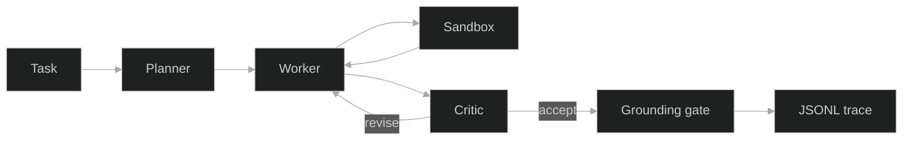
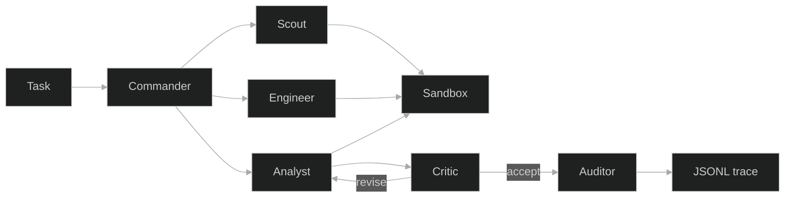

# Orbit

<p align="center">
  
</p>

A local planner, worker, and critic that answers a question over a bundled makerspace corpus only when its sandboxed tools support the claim.

[](https://github.com/shmorsi/orbit-multi-agent/actions/workflows/ci.yml)
[](https://www.python.org/downloads/)
[](LICENSE)

[Mission Control](https://shmorsi.github.io/orbit/) · [Portfolio](https://shmorsi.github.io/) · [Architecture](#architecture) · [Results](#results) · [Reproducibility](#reproducibility) · [Limitations](#limitations)

## Thirty seconds

| | |
| --- | --- |
| **What it is** | Three roles on one bus. The planner writes at most four steps. The worker calls one sandboxed tool or states a final answer. The critic accepts the claim or sends it back. A grounding gate drops anything the tool results do not support. |
| **Why it matters** | A tool-calling model can emit valid JSON and still invent the number. Orbit separates those two failures and scores them once on a frozen test. The page reports what landed, including the comparison that did not clear zero. |
| **Key results** | QLoRA on Qwen2.5-1.5B moved the schema-valid rate from 0.607 to 0.780, shown to three decimal places. That paired interval is above zero. Task success went from 2 of 12 to 3 of 12, and that paired interval includes zero, so the adapter is not separated from the base team on task success. Claude score-v1, Claude score-v2, and the T4 distill run are pending. |

Fine-tuning taught the format. It did not separate the runs on task success. The files in `results/v2_qwen1.5b/` hold the full values.

## Quick start

Python 3.11 or newer. These commands install the harness, time one scripted task, and run the suite. They do not download a model and they do not score the frozen test.

```bash
python3 -m venv .venv
source .venv/bin/activate
python -m pip install -e ".[dev]"
python -m orbit_agents.doctor
python -m pytest
```

`python -m orbit_agents.doctor` prints JSON. `scripted.ok` is true and `scripted.kind` is `scripted_harness`. That is a harness check, not a model score. `pytest` includes the check that the results block below matches the files.

Mission Control on this machine:

```bash
python -m orbit_agents.serve
```

Open the localhost URL the server prints. Pick a bundled task id for the scripted harness. A free-form question needs a model backend. Platform notes are in [Run it locally](#run-it-locally).

## Architecture

<p align="center">
  
</p>

The measured numbers on this page are this three-role team, harness v2, archived in `results/v2_qwen1.5b/`. The picture is drawn by `docs/build_figures.py` from those files and from the constants in the engine. It is not a stock image.

**Planner.** One JSON object. At most four steps, or an empty plan when the corpus cannot answer.

**Worker.** One JSON object: a tool call, or a final answer with claims. Each claim cites a tool result.

**Critic.** One JSON object. It accepts a grounded claim or sends the draft back, at most 2 times.

**Grounding gate.** Code, not another model turn. A claim stays when the cited tool result contains it, when a python call printed the count, or when the count equals the number of matching lines in the cited text. Otherwise the gate refuses the claim.

**Sandbox.** The worker may call `calculator`, `read_file`, `write_file`, `python`, `retrieve`, or `web_search`. `web_search` reads a bundled cache. Nothing in the tool path opens a socket. The Python tool runs in a child process and is killed after one second.

The team stops after 8 turns. A broken schema gets 2 tries on that turn.



## v2: six roles

`--team v2` runs the same tasks, the same tools, and the same grounding gate with six seats instead of three. `--team v1` stays the default, so every measured number on this page is a v1 team result. The six-role team has not been scored. Traces in `mission/traces/v2/` come from the scripted harness, which follows each task's oracle. They show the protocol, not model skill.



| Role | Tools | Can answer |
| --- | --- | --- |
| Commander | none; assigns each step to one specialist | no |
| Scout | retrieve, read_file, web_search | no |
| Engineer | python, write_file | no |
| Analyst | calculator | yes, the only seat that drafts the final |
| Critic | none | no; accepts or sends the draft back, at most 2 times |
| Auditor | none; read-only copy of the trace | no; the v1 grounding gate, one finding per claim and per number |

Every seat calls `LLMClient.complete(messages, schema)` in `src/orbit_agents/policy.py`. Backends: scripted, transformers, ollama, llama.cpp, and anthropic. Adding a provider is one class. `OpenAICompatiblePolicy` is the documented stub. The policy sees the role prompts and the task. It does not see the checker contract the distillation teacher gets, or any frozen-test content. The limits are the v1 limits: 8 turns, 2 revise passes, and 2 schema tries on a turn.

```bash
python -m orbit_agents.eval.run --team v2 --split test --out traces/v2_check.json
make traces-v2
make score-dry-run MODEL=claude-haiku-5-5
```

`make score-dry-run` checks the frozen test hash and tag and prints the request bound. It does not read an API key. With a key, `make score-v1` and `make score-v2` each score the frozen test once. Those two scores are pending.

## Results

<!-- RESULTS_START -->
Rates, losses, and intervals below are the committed values, shown to three decimal places. The JSON files hold the full values.

Measured once on the frozen test `team-eval-v1`, Qwen2.5-1.5B-Instruct, QLoRA, 307 train dialogues and 71 tune dialogues. Files: `results/v2_qwen1.5b/`. Logged loss went from 1.152 at step 10 to 0.051 at step 150. Task success did not clear zero.

| Run | Successes | Task-success rate | Schema-valid rate | Trap refusals |
| --- | --- | --- | --- | --- |
| Single base | 2 of 12 | 0.167 | 0.750 | 2 of 2 |
| Team base | 2 of 12 | 0.167 | 0.607 | 2 of 2 |
| Team plus adapter | 3 of 12 | 0.250 | 0.780 | 1 of 2 |
| Team distill | not scored | | | |

The adapter's two answerable successes sit next to a missed trap: correct refusals went from 2 to 1. The paired bootstrap for task success, adapter minus team base, is -0.167 to 0.333 (point 0.083). That interval includes zero. The same pair's schema-valid interval is 0.001 to 0.339 (point 0.173). That interval is above zero. Schema-valid rate moved. Task success did not, on this 12-task set.


The earlier 0.5B run is in `results/v1_qwen0.5b/`. Successes were 2 of 12, 2 of 12, then 1 of 12, with schema-valid rates 0.000, 0.071, and 0.613. Logged loss went from 1.319 to 0.200. Its task-success interval also failed to clear zero. Fine-tuning taught the format.

The placeholder files at the top of `results/` stay pending. A harness file in `results/` is a system check of the scripted tools, not a model score. Team distill is a fourth config. It has not been scored.

The harness changed in v3. Search now lists tables and logs, python can read a bundled file by path, a count printed by python or equal to the matching lines in the cited text stays grounded, and the critic must return one JSON object. The v2 numbers above stay archived in `results/v2_qwen1.5b/`. single_base, team_base, team_lora, and team_distill must be scored again on the frozen test under v3 before any comparison. Those v3 scores are not in yet.

Pending slots. A row here is not a result. Score-v1 and score-v2 on Claude, and the QLoRA distill run on a T4, stay here until a measured file exists. The v3 rescores of the archived runs stay here for the same reason.

| Slot | File | Status |
| --- | --- | --- |
| Single base, harness v3 | `results/v3_qwen1.5b/single_base.json` | pending |
| Team base, harness v3 | `results/v3_qwen1.5b/team_base.json` | pending |
| Team plus adapter, harness v3 | `results/v3_qwen1.5b/team_lora.json` | pending |
| Team distill, QLoRA on a T4, harness v3 | `results/v3_qwen1.5b/team_distill.json` | pending |
| Claude policy, three-role team, harness v3 | `results/v3_api/<model>/team_v1.json` | pending |
| Claude policy, six-role team, harness v3 | `results/v3_api/<model>/team_v2.json` | pending |
<!-- RESULTS_END -->

## Reproducibility

Protocol `team-eval-v1`. The frozen file is `eval/test.jsonl`. Its hash is in `eval/manifest.json`, and the tag `team-eval-v1` points at the commit that introduced that file. Later commits may change code. They may not change the test file. The rules are in [eval/PROTOCOL.md](eval/PROTOCOL.md). Gold answers were produced by running the tools, then checked a second way. `finetune/leakage.py` keeps the frozen test, its near-duplicates, and its oracle calls out of the training pool. The training rules are in [finetune/PROTOCOL.md](finetune/PROTOCOL.md).

Each archived model was trained once and scored once. There is no seed sweep. Do not score the frozen test in a loop. Iterate on the tune split:

```bash
python -m orbit_agents.eval.run --split tune --backend scripted --out traces/tune.json
python finetune/leakage.py
```

The results block is generated. Edit the generator, not the numbers:

```bash
python -m orbit_agents.eval.readme
python -m orbit_agents.eval.readme --check
python docs/build_figures.py --check
```

`--check` fails when this page or the diagrams disagree with the files.

## Limitations

- The frozen test is 12 tasks, 2 of them traps. One task moves a rate by a twelfth, so only a large effect can clear zero.
- Each archived model was trained once and scored once.
- The adapter that added a success also missed a trap: correct refusals went from 2 to 1.
- The harness changed in v3. The v2 numbers stay archived. No v3 model score is in yet, so this page does not compare v2 with v3.
- Team distill has not been scored. Claude score-v1 and score-v2 have not been scored. The free-T4 wall clock has not been measured.
- Scripted traces follow the oracle. They are a harness check, not a model score.

## What I'd do next

1. Score the three-role team and the six-role team once each on the same Claude model, with `make score-v1` and `make score-v2`. The generator will add the rows when those files are measured. Until then they stay pending.
2. On a free T4, run [the distill notebook](notebooks/run_distill_and_score.ipynb) once: teacher dialogs under the request cap and the 5 USD stop, QLoRA from `finetune/configs/qlora_distill.json`, then one frozen score of `team_distill` and the v3 baselines. That run is not measured here.
3. Leave `results/v2_qwen1.5b/` as the archive. Compare harness v3 only after `single_base`, `team_base`, `team_lora`, and `team_distill` each have one measured file under `results/v3_qwen1.5b/`.

## Run it locally

The demo target is an 8 GB machine with the 0.5B model. The 1.5B model can run in fp16 and is slow on that machine. QLoRA and bitsandbytes are CUDA-only. `pip install -e ".[dev]"` does not install them. The demo never imports them. Pins for a local model live in `requirements-infer.txt`. Colab training pins live in `finetune/requirements-colab.txt` and do not reinstall torch.

`make doctor` prints seconds for the scripted harness on the machine you run it on. `make doctor-live` downloads Qwen2.5-0.5B-Instruct and prints seconds for one real task. This page does not publish those readings.

### M1 Mac

```bash
python3 -m venv .venv
source .venv/bin/activate
python -m pip install -e ".[dev]" -r requirements-infer.txt
python -m orbit_agents.doctor
python -m orbit_agents.doctor --live
python -m orbit_agents.serve
```

`doctor` should print `mps` when PyTorch can see the GPU, and `cpu` when it cannot. Open the localhost URL. Pick a bundled task id with the scripted harness, or type a question and choose Transformers.

### Linux

```bash
python3 -m venv .venv
source .venv/bin/activate
python -m pip install -e ".[dev]" -r requirements-infer.txt
python -m orbit_agents.doctor
python -m orbit_agents.doctor --live
python -m orbit_agents.serve
```

Without CUDA or MPS the device line is `cpu`. The same Mission Control page streams the run.

### Windows

`make` may be missing. From a Python 3.11 venv:

```bat
py -3.11 -m venv .venv
.venv\Scripts\activate
py -3.11 -m pip install -e ".[dev]" -r requirements-infer.txt
py -3.11 -m orbit_agents.doctor
py -3.11 -m orbit_agents.doctor --live
py -3.11 -m orbit_agents.serve
```

The Windows device is `cpu`. The Python tool still dies after one second. The limit is a child process.

### What you should see

Mission Control shows the planner, the worker, a tool call in the telemetry strip, and the critic. The phase rail steps Planner, Worker, Tool, Critic. Under the replay, the flight-data wall charts the frozen 1.5B runs with bootstrap intervals, the loss curve, the trap outcomes, and an empty slot for team distill. The T+ column is a replay clock, not measured latency.

`mission/index.html` is static. GitHub Pages can host the `mission` directory, and the same files open under `python -m orbit_agents.serve`. The run form needs the local server. `prefers-reduced-motion` turns the pulses off.

Record the clip again with `python demo/record_replay.py`. It needs Chrome and ffmpeg.

Troubleshooting:

- `torch is not installed` means the infer requirements have not been installed. QLoRA is still not required for the scripted demo.
- `mps` missing on an M1 means the demo is on CPU. The 1.5B model is slow there. Use the 0.5B model or Ollama for a shorter wait.
- A free-form question with the scripted harness returns an error. That backend only runs a bundled task id.
- Out of memory: stay on the 0.5B default. Do not install bitsandbytes on a Mac to make QLoRA work. That stack is the Colab path.

## Distillation

The templated dialogs taught the JSON shape and not the counting. `finetune/distill_teacher.py` asks a teacher to act as planner, worker, and critic on train and tune tasks only. Each tool call runs in Orbit's sandbox. A trajectory is kept only when the task checker passes and every turn matches the role schema. Trap tasks stay in the pool so a correct refusal can be kept. The generator adds count, sum, threshold, log, quotient, write, and refusal variants on top of the templated train tasks. Gemini and Claude write the same dialog files. Each kept dialog records the teacher model in its metadata, and `stats.json` records it too.

The frozen test is a local blocklist. Its ids, questions, near-duplicates, distinctive fragments, and oracle calls are not placed in a request and are not written as rows. `--dry-run` prints the pool and does not read an API key.

```bash
python finetune/distill_teacher.py --dry-run
export ORBIT_ANTHROPIC_API_KEY=your-key
python finetune/distill_teacher.py \
  --provider anthropic \
  --model claude-haiku-5-5 \
  --max-requests 800 \
  --requests-per-minute 20 \
  --max-cost-usd 5 \
  --attempts 3 \
  --output finetune/data/distill
```

The default provider is Anthropic and the default model is `claude-haiku-5-5`. A name that starts with `claude` selects Anthropic even without `--provider`. `--model` also accepts the Sonnet and Opus ids in the price table. The key is read from `ORBIT_ANTHROPIC_API_KEY`. Requests omit temperature unless you pass `--temperature`. The reply is taken from text blocks only. The teacher prompt includes the final-answer JSON and the tool-call JSON the checker scores, including the claim names for that task. Pass `--families` and `--limit-tasks` to try a few tasks, and `--debug-dir` to keep every attempt.

Cost controls, from `finetune/distill_teacher.py`:

- The hard cap defaults to 800 requests for this run. The checkpoint still records the running total. A restart is not blocked by that total unless you also set `--max-total-requests`.
- The pace defaults to 20 requests per minute for Anthropic. Request logs include input tokens, output tokens, and a running cost estimate in USD. The estimate uses the price table in the script, which is also recorded in `finetune/configs/qlora_distill.json`. An unknown model uses the fallback price, 15 dollars per million input tokens and 75 dollars per million output tokens, so the cost limit cannot be under-counted. At 5 USD the run stops and writes the checkpoint.
- A response that says the credit balance is too low, or any other billing error, stops the same way.
- HTTP 429 and overloaded or other server errors wait 20 seconds, then 40, then 80, and each retry counts toward the cap. A per-minute HTTP 429 whose stated retry delay is 120 seconds or less waits that long once and continues. A per-day quota, a longer delay, or a second consecutive 429 stops the process.
- Any other client error stops on that response. The run does not send another request.
- With `--provider gemini`, set `ORBIT_TEACHER_API_KEY`. That path keeps the free-tier pace of 4 requests per minute and does not apply the dollar limit. A model whose name starts with gemma does not receive a system instruction field. That text is placed in the first user turn.
- If the Google project has billing turned on, successful calls can still incur charges up to the cap. Confirm billing is off before you export the key.

A stopped run resumes from `finetune/data/distill/checkpoint.json`. The kept dialogs are `train.jsonl` and `tune.jsonl` in that directory, in the same message format as the templated set, plus `stats.json` with attempts and pass rate per task family.

Train the student with `finetune/configs/qlora_distill.json`. Do not score the frozen test in a loop.

## Fine-tune

[](https://colab.research.google.com/github/shmorsi/orbit-multi-agent/blob/main/finetune/colab_train.ipynb)

On a free T4, open [`finetune/colab_train.ipynb`](finetune/colab_train.ipynb) and run it from the top. The default cell trains `finetune/configs/qlora_medium.json` (Qwen2.5-1.5B-Instruct, QLoRA). It targets a free T4 with 16 GB and about 60 minutes for training plus the three evals. That wall clock has not been measured here.

- Optional: set `ORBIT_MOUNT_DRIVE=1` before the first code cell to mount Drive. Otherwise checkpoints stay on the runtime disk under `/content/orbit-checkpoints`.
- Upload the project zip to `/content/orbit.zip` to train that copy. With no zip, the notebook clones https://github.com/shmorsi/orbit-multi-agent.
- The install cell uninstalls torchao, installs `finetune/requirements-colab.txt` with `--upgrade-strategy only-if-needed`, then `pip install -e . --no-deps`, and runs the leakage check.
- Score the frozen test once: single base, team base, team plus the adapter. Set `ORBIT_DISTILL=1` only when the distilled JSONL is in the zip. That adds `team_distill` and does not repeat the three scores in a loop.
- Set `ORBIT_RESCORE=1` before the rescore cell to write the four v3 scores once under `results/v3_qwen1.5b/`. That cell does not train. The v2 numbers stay archived.
- Zip those files to `/content/outputs.zip` and download it.

`finetune/configs/qlora_small.json` is the 0.5B config from the measured v1 run. `--method lora` is the MPS or CPU training path. On an M1, prefer that 0.5B config or Ollama.

### Distill and score in one notebook

[](https://colab.research.google.com/github/shmorsi/orbit-multi-agent/blob/main/notebooks/run_distill_and_score.ipynb)

[`notebooks/run_distill_and_score.ipynb`](notebooks/run_distill_and_score.ipynb) runs the team-distill path end to end on a free T4: the Claude teacher (`claude-haiku-5-5` by default, `claude-sonnet-5-5` as an option) under the same request cap and cost stop, QLoRA with `finetune/configs/qlora_distill.json`, one frozen score into `results/v3_qwen1.5b/team_distill.json`, the v3 baselines it needs (each once, skipped if present), the paired comparison, and a regenerated README results block. Add the key as a Colab secret named `ORBIT_ANTHROPIC_API_KEY` before running. It is read from secrets or the environment and never printed.

## Mission Control

The replay below is a saved engine trace, not a mock. The flight-data wall under it reads `results/v2_qwen1.5b/`.


<video src="docs/mission-control.mp4" controls muted playsinline></video>


## What I built

The team loop, the six tools, the frozen split, the leakage check, the optional LoRA trainer, the teacher distillation script, and Mission Control. The measured model scores are the 0.5B run and the 1.5B run in [Results](#results). Team distill, Claude score-v1, and Claude score-v2 are the next scores. They are not claimed here.
